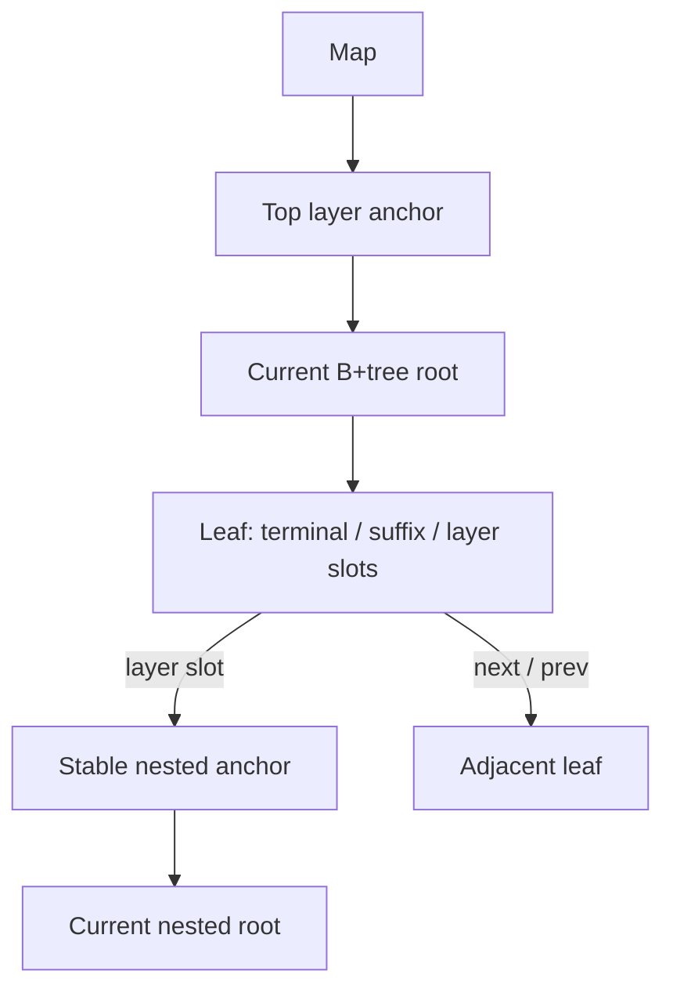

# Refined Masstree Architecture

Generated by: Opus 5.5 (max effort)

**Status:** proposed replacement architecture with executed supporting
experiments; implementation and release gates remain open.  
**Target:** a Rust concurrent ordered byte-key map for x86_64 and AArch64.  
**Workload priority:** mixed point reads/writes with frequent range scans.  
**Consistency:** linearizable point operations; exact, ordered scans without a
whole-scan snapshot.  
**Research baseline:** Rust `eb8bee2e546e4713b2ae37eda07395150cdf628e`, crate
0.9.5; C++ Masstree `11198427a1170654ca646dd20d96c8f349bca2bd`.  
**Review date:** 2026-10-23.

This document specifies a replacement design. It is not a description of the
current implementation and does not inherit its correctness claims. A design can
identify invariants, proofs and acceptance tests; superiority in throughput or
latency must be demonstrated by a working implementation. “Maximum performance”
means selecting the best measured design for the agreed workload while
satisfying the same correctness contract on both target architectures.

## 1. Contract and decision rules

The implementation must provide:

- Arbitrary binary keys, including the empty key and embedded NULs, in unsigned
  bytewise lexicographic order. Preserve the current 256-byte limit initially;
  reject longer keys before changing the tree.
- Linearizable insert, replace, get and remove, including negative results. A
  successful removal must identify the full key again under its write lock.
- Forward and reverse ranges with exact inclusive/exclusive bounds, exact prefix
  membership, and identical membership across keyed and values-only APIs.
- Strictly ordered, duplicate-free scan output. A scan over a quiescent map
  returns every matching key exactly once. Concurrent changes do not imply a
  snapshot; their precise visibility rules will be specified with the cursor
  protocol.
- Rust memory safety for all safe public calls, including misuse of guard
  affinity, retained outputs, empty batches and panicking user code.
- Reclamation of removed values and empty structure after readers quiesce and
  maintenance receives sufficient execution time. Queue exhaustion must not
  silently abandon necessary cleanup.
- Explicit progress guarantees. Optimistic readers that retry or wait for a
  writer are not advertised as formally lock-free or wait-free.

Performance decisions are gated by correctness. Track throughput, p50/p99/p99.9,
bytes per live key, retained bytes, allocations per operation, retry counts and
maintenance work. Compare equal key/value representations, operations, guards,
allocators, thread placement and correctness checks. A broken fast path cannot
serve as an acceptable replacement baseline.

## 2. Evidence from the current implementation

The original C++ repository was cloned from
[`kohler/masstree-beta`](https://github.com/kohler/masstree-beta) into
`/tmp/masstree-reference` and pinned by its full commit above. Local scratch
logs and verification scripts are in `/tmp/masstree-doc-review`; those temporary
paths are session aids, not durable repository dependencies.

### 2.1 Current Rust implementation

These checks were executed against the current worktree, not inferred from
existing documentation:

| Check | Observed result | Architectural consequence |
|---|---|---|
| `cargo test --offline --lib` | 610 passed | Unit-test success is compatible with the failures below |
| `leak_tests`, `batch_insert_tests`, `true_inline` | 20, 28 and 6 passed | Add adversarial ownership/range tests beyond these suites |
| Existing Loom models | 12 passed | They model components, not the full leaf/GC protocol |
| Library feature checks | Default, no-default, all-features, sidecar, small suffix and no-prefetch passed | Compilation is not a portable memory-model proof |
| All targets without default features; strict Clippy | Existing example failure; four distinct lint errors | Tooling defects remain separate from the redesign |
| Miri `valueptr_escape` | Dangling `&String` | Borrowed outputs must carry a guard borrow |
| Miri `valueptr_race` | Non-atomic read versus atomic store | Immutable borrowed values and atomic word values need distinct APIs |
| Miri `padded_write_through` | Uninitialized bytes loaded as an atomic word | Size/alignment/`needs_drop` do not establish an encoding contract |
| Miri `move_value_same_leaf` | Dangling `Box<u64>` during destruction | Pointer copying must not duplicate ownership |
| Miri `batch_write_through_leak` | Leaked 8-byte allocation | Batches must own values and old-result ownership must be explicit |
| `failures/concurrency/vercheck` | Two new inserts leave version `0xc0000000`; update changes it to `0xc0000008` | Publication must be proved using the actual version and permutation protocol |
| `prepend`, `equal_run`, `equal_run2` | Lost point-lookup key / `SplitFailed` panics | Split the conceptual post-insert sequence at a strict ikey boundary |
| `nul`, `nulpfx`, `layerend`, `promoted`, `vals`, `valfar`, `maxprefix`, `doubleended`, `empty_right` | Bound, completeness, duplication and empty-tail defects reproduced | Use one validated full-key cursor for every scan adapter |
| `sublayer_leak` | 4 leaves + 1 internode remain after draining; 3 jobs abandoned | Cleanup must work inside promoted layers and keep durable retry intent |
| `double_unlink_deterministic` | Watchdog exit 42 | Durable maintenance jobs must not own unprotected raw node pointers |
| Batch `mut`, `leak3` | Routing corruption; 2,000 allocations retained after dropping entries | Private coherent key metadata; normal value ownership before publication |

Miri used nightly `0.1.0 (7189d39d9c 2026-10-22)` with strict provenance and
symbolic alignment checks. Native checks used Rust 1.99.1 on x86_64 Linux. No
AArch64 runtime result has been obtained. Many diagnostic binaries return zero
while printing a mismatch; their exit code alone is not an oracle.

### 2.2 Corrections to the inherited audit model

Source remains authoritative over `SystemAudit.md` and `ARCHITECTURE.md`. The
redesign must not build on these overstatements:

- `InternodeNode::set_ikey` and `set_child` use ordinary checked array indexing.
  Removing a `debug_assert!` in release does not remove that bounds check.
  Separate safe methods do dereference caller-provided pointers, which is a
  different API-soundness issue.
- The promoted-layer retention case remains reachable and is ordinarily freed by
  tree destruction. It is a failure of online reclamation, not proof that
  ordinary teardown loses that subtree.
- The C++ insert path also conditionally skips a version bump for a fresh slot.
  That optimization depends on its complete publication, permutation, slot-reuse
  and removal protocol. A constant version word alone does not prove that every
  possible fresh-slot insertion protocol is incorrect.
- Release/acquire synchronization depends on which atomic write a load observes,
  not whether two writes carry different numeric values.
- Neither copying C++ compiler fences nor passing the existing Loom tests
  establishes Rust correctness on AArch64.

### 2.3 Initial C++ lessons

References below are relative to the pinned C++ checkout.

| Source | Observation | Design implication |
|---|---|---|
| `nodeversion.hh::has_changed` | Ignores only the writer lock bit, not the insertion dirty bit | An in-flight structural mutation must invalidate a reader |
| `masstree_get.hh::find_locked` | Rechecks both version and permutation after locking | Optimistic logical slot positions are not write authority |
| `masstree_split.hh::ikey_after_insert`, `split_into` | Picks a boundary in the sequence including the incoming key, then keeps equal ikeys together | Use one split planner for append, prepend and general insertion |
| `masstree_scan.hh::find_next` | Validates after gathering candidate data and before emitting it | Callbacks and iterator yields must follow validation |
| `masstree_remove.hh::gc_layer` | Finds the true root and trims redundant internodes before deleting an isolated empty leaf | Layer cleanup must handle root promotion explicitly |
| `masstree_struct.hh::full_version_value` | Includes size along with version for some observations | Optimizations require a documented observation token |
| `compiler.hh` | Uses compiler barriers and x86 instructions | Reconstruct synchronization using Rust atomics; do not translate macros literally |
| `doc/spec.tex` | Explicitly says its removal description is outdated | Treat the specification as context and verify the live code |

## 3. Proposed core

Retain Masstree's useful organizing principle: a trie of small B+trees over
8-byte chunks, with suffix compression until chunks conflict. The initial
candidate keeps 15-slot leaves and evaluates internode width independently.
Neither width nor cache-line padding is frozen until layout and workload
measurements justify it.

The design replaces the current protocol boundaries:

1. **Stable layer anchors.** A layer slot refers to a stable `LayerAnchor`
   containing the current root pointer. Root promotion changes that pointer,
   rather than leaving every reader and collector to rediscover the root via an
   obsolete left leaf. Guard protection covers anchors as well as nodes.
2. **Atomic metadata, immutable published bytes.** Readers snapshot atomic node
   fields. Suffix regions and boxed values are immutable after publication. A
   retry cannot retroactively make a plain data race legal.
3. **Explicit value representations.** A word policy uses defined encoders into
   atomic integers. A general-value policy uses immutable allocations and
   guarded references. No arithmetic heuristic enables write-through for an
   arbitrary `V`.
4. **Validated snapshots before interpretation.** Gather tags, pointers, lengths
   and value bits, validate the node, then interpret or dereference the captured
   payload. An observed layer pointer must never be exposed as a user value.
5. **One traversal and cursor contract.** Get, writes, maintenance and scans
   share layer-root normalization, fence checks and restart rules. Scan adapters
   share full-key comparison, exhaustion and duplicate suppression.
6. **Prepared structural transactions.** Discover the affected nodes and reserve
   storage before mutation; lock and revalidate the complete affected set;
   commit without allocation or user code. Contention before mutation may
   restart. Published partial structure must have a specified recovery path and
   cannot be abandoned.
7. **Logical maintenance jobs.** Queue owned layer routes and range identifiers,
   then resolve live nodes under the processing guard. Duplicate jobs are
   harmless. Failed attempts preserve cleanup intent for later work.

These are design decisions for the first implementation, not measured
performance victories. Sections below separate mandatory invariants from
optimizations that need further evidence.

## 4. Structure and key representation

### 4.1 Why retain the trie of B+trees

The priority is mixed operations with frequent ordered scans. Keep contiguous
leaf batches and chunk routing, then remove duplicated protocols and unsafe
ownership. This is an engineering hypothesis, not a claim that every radix tree
loses to Masstree. The original design motivates chunked B+trees, local writer
locks and cache-conscious traversal; its historical benchmark numbers are not
predictions for this implementation or modern ARM machines.
[Original Masstree paper](https://pdos.csail.mit.edu/papers/masstree:eurosys12.pdf).

| Candidate | Relevant advantage | Required comparison before adopting |
|---|---|---|
| Refined Masstree | Ordered leaf batches; compressed unshared suffixes; bounded chunk comparisons | Anchor overhead, structural retries, memory per prefix-heavy key |
| Conventional optimistic B+tree | One tree; no layer anchors | Full-key comparison and prefix compression cost for long shared keys |
| ART | Adaptive fanout and ordered radix traversal | Equivalent concurrent deletion, reverse scans, reclamation and binary-key semantics |
| HOT | Reduces trie height by varying the discriminating span | Portable implementation and the complete update/delete contract |
| Immutable copy-on-write nodes | Simple immutable reader snapshots | Allocation, copying and retained memory under the selected write/scan mix |

ART supports ordered range and prefix operations; it is not disqualified as an
unordered index. The linked HOT reference implements concurrent insert, lookup
and scan, but does not provide concurrent deletion in that version. These are
comparison candidates, not measured runners-up.
[ART paper](https://db.in.tum.de/~leis/papers/ART.pdf),
[HOT reference implementation](https://github.com/speedskater/hot).

### 4.2 Exact binary keys

`KeyRef` validates length once. Read each chunk as up to eight bytes, zero-pad
only for the numeric `ikey`, and use big-endian interpretation. Keep the actual
remaining length separately. Do not treat padding as a key terminator.

Within a layer, a slot is one of:

- `Terminal(0..=8)`: the key ends in this chunk;
- `Suffix`: a value with immutable remaining bytes longer than this chunk;
- `Layer`: a continuation through a stable anchor.

The semantic order is full unsigned bytewise key order. Numeric ikey equality
only narrows the search. For example, `b"a"`, `b"a\0"` and `b"a\0\0"` are
distinct ordered keys. Terminal slots with equal padded ikeys sort by their
actual length. The continuation follows a terminal of length eight. At most one
continuation slot exists for a particular ikey; a suffix collision converts it
into a layer.

All slots with the same ikey stay in one leaf. There can be at most ten: nine
terminal lengths `0..=8`, plus one continuation. This includes the empty key.
Consequently, a full 15-slot leaf plus one new slot cannot consist solely of one
ikey group. A strict split boundary exists after collision conversion. This
argument must remain true if leaf width becomes configurable: widths below the
largest permitted group need a different representation.

### 4.3 Layer anchors and routing

The map owns a top-level `LayerAnchor`. Each nested layer slot owns exactly one
anchor. An anchor contains a version/lock word, a never-reused identity, the
current atomic root pointer and an active/retired state. Its logical prefix is
available as an owned route for maintenance. The anchor's lifetime is protected
by the same reclamation domain as nodes.

Every descent starts with a validated anchor snapshot. Promotion or root
contraction updates `anchor.root`; it never depends on climbing from an old left
leaf. A parent pointer is an optional writer hint, not reader authority. An
acquired stale root is still memory-safe under the guard; its version and fences
determine whether traversal can continue or must restart.



Every node has a half-open ikey interval `[low, high)`. Infinity uses explicit
flags, never a reserved key such as zero or `u64::MAX`. Leaf low bounds are
stored independently of slot zero. Empty leaves still have valid intervals.
Search validates the node before trusting its child pointer or routing result.

The initial design has bidirectional B-link **leaf** chains. Internodes use
validated fence checks and restart from the anchor when a stale route falls
outside their interval. This avoids adding sibling edges at every internal level
to the first reclamation protocol. Internal right links are a possible later
optimization, with their own unlink and retirement obligations.

A clean internode has `1..=capacity+1` non-null children. Child heights are
equal and one below its immutable height. Unary non-root internodes are
temporarily legal while maintenance catches up; zero-child published internodes
are not. Only an anchor's root may be contracted to a lower-height child without
rebuilding its ancestors.

## 5. Node storage and ownership

### 5.1 Initial layout budget

Use explicit layouts and compile-time assertions for each supported target. The
following are **calculated candidate budgets**, not measured allocations of an
implemented replacement. They assume 64-bit pointers, 64-byte alignment, 15 leaf
slots, and a lazy suffix sidecar.

| Object | Fields included | Candidate rounded size |
|---|---|---:|
| Common node header | version, identity, parent hint, low, high, kind/height/flags | 48 B |
| Leaf navigation header | common header + next + prev | 64 B |
| Boxed-value leaf | header + permutation + tags + ikeys + atomic payload pointers + suffix pointer | 384 B |
| Word-value leaf | boxed shape with separate atomic words and layer pointers | 512 B |
| 15-key internode | common header + count + separators + 16 child pointers | 320 B |

Boxed values, anchors, suffix indexes, suffix bytes, allocation rounding and
retired objects are extra. Report total allocated bytes, not just `size_of`. The
separate pointer array in a word leaf deliberately avoids interpreting integer
bits as pointer provenance. A future tagged-pointer layout needs a separate
provenance argument and Miri coverage.

Compare this with the current source's asserted leaf sizes: boxed 448 B; inline
default 1,152 B; inline small-suffix 896 B; inline sidecar 576 B. These are
verified by feature compilation in `src/leaf15/layout.rs`. The current
permutation occupies its own padded cache line even though normal writers
already hold a leaf lock. The replacement starts compact and tests separate
padding only if contention measurements justify it.

Leaf width 15 is the first candidate because a size plus 15 four-bit slot
indices fits in one atomic 64-bit permutation. Use a specialized permutation
type with an explicit free-slot set; do not inherit partially generalized
`Permuter<WIDTH>` arithmetic. Internode width can be varied independently. Tests
must cover every occupancy and encode/decode round trip.

### 5.2 Two explicit value policies

**Word storage:** support a sealed set of types with explicit total encoders and
decoders into `u64`. Start with unsigned/signed integers up to 64 bits and
explicit float bit encodings. Decode only validated stored values. Returns are
owned values, loaded atomically. Do not infer permission to transmute from
`Copy`, size, alignment, or absence of `Drop`. References, pointer-bearing
types, padding and arbitrary enums do not enter this path automatically.

**General storage:** publish an immutable allocation for each value. Replacing a
value publishes a new pointer; removing or replacing the old allocation defers
its destruction. An old guarded reference remains valid and immutable. `Arc<T>`
is an ordinary supported value for callers who want cheap owned copies. No
write-through mutation of an allocation that can be borrowed as `&V`.

Here “immutable” means the tree never mutates the published `V` in place.
Caller-visible interior mutability, such as atomics or a mutex inside `V`,
continues to follow that type's rules. The map does not promise a deep snapshot
of state that callers independently mutate through such a value.

Before publication, `OwnedValue<V>` owns destruction. After publication, one
live slot owns the allocation. A move transfers that ownership exactly once:
inactive source bytes do not own a value, and node destruction visits only owned
live entries. A retired value has one retirement record. Borrowed `ReadRef`
objects never enter the insertion path as owned values.

### 5.3 Immutable suffix regions

Allocate a suffix index only when the leaf first needs suffix storage. The index
contains atomic per-slot offset/length descriptors and an atomic pointer to a
fixed-capacity byte arena. Readers never inspect a mutable `Vec::len`. The arena
capacity is immutable; the append cursor belongs to the writer.

Append writes only previously unused bytes. Published regions are immutable
until the entire arena is reclaimed. A writer uses raw access through a narrowly
scoped `UnsafeCell` backing allocation; it must not construct an exclusive
reference covering bytes that readers can still borrow. Metadata publication
follows the dirty/version protocol. Readers capture the arena pointer and
descriptor atomically, validate, check the captured bounds, and only then form a
byte slice. The guard covers the arena lifetime.

On exhaustion or excessive fragmentation, prepare a new arena, copy live
suffixes, then publish its pointer and all descriptors in one dirty leaf
mutation. Retire the old arena after detachment. Never reallocate or compact
published bytes in place. Splits and layer conversion may copy suffixes; they
must not retain an unowned pointer into a source leaf's private storage.

Evaluate 128/256/512-byte initial arenas and growth slack against real suffix
distributions. The maximum live suffix payload in a 15-slot leaf is bounded by
`15 * 248 = 3,720` bytes before overhead. Shared long prefixes should become
layers instead of being copied into every key on every operation.

## 6. Rust memory model and snapshot protocol

### 6.1 Version states

Use a 64-bit atomic word: low bits `LOCK`, `DIRTY`, `RETIRED`; remaining bits
form a monotonically increasing sequence. A clean lock reservation changes no
reader-visible data, so readers may ignore `LOCK` alone. They must never ignore
`DIRTY` or `RETIRED`. Every mutation in the first implementation advances the
sequence, including a fresh-slot insert and a value replacement.

Sequence wrap is not an allowed ABA event. Reserve headroom and replace a node
before its counter is exhausted, using the structural protocol. An exhausted
identity allocator must fail before publication rather than reuse an identity.
These paths need reduced-bit test configurations; “64 bits is large” is not the
correctness argument.

### 6.2 Atomic metadata protocol

Illustrative pseudocode below omits the reclamation adapter. `field` means an
atomic field; it never means a plain concurrently changing struct member.

```rust,ignore
// Writer: exclusive reservation already acquired with an Acquire CAS.
version.store(sequence | LOCK | DIRTY, Relaxed);
fence(Release);                      // announce dirty before field writes
field_a.store(new_a, Relaxed);
field_b.store(new_b, Relaxed);
version.store(next_sequence, Release);

// Reader: guard established before following any published pointer.
let before = version.load(Acquire);
if before & (DIRTY | RETIRED) != 0 { return Retry; }
let a = field_a.load(Relaxed);
let b = field_b.load(Relaxed);
fence(Acquire);                      // field reads before final validation
let after = version.load(Relaxed);
if (before & !LOCK) != (after & !LOCK)
    || after & (DIRTY | RETIRED) != 0 { return Retry; }
// Only now interpret the captured tag/pointer/length combination.
```

The proof has two parts. Observing a committed sequence with the initial Acquire
load imports the preceding committed state. If any captured field instead
observes a later writer's store, the writer's Release fence and the reader's
Acquire fence synchronize through that atomic field. The dirty store therefore
happens before final version validation, preventing acceptance of the old
sequence. A snapshot that observes only old fields may be accepted before the
concurrent mutation. Equal numeric field values do not invalidate the reads-from
argument.

This argument uses the documented fence-to-fence synchronization rule. A final
Acquire **load alone** is not a substitute for the reader fence, and plain
racing loads are not made legal by validation.
[Rust atomic fence semantics](https://doc.rust-lang.org/std/sync/atomic/fn.fence.html).

This proves the intended metadata pattern subject to atomic coherence,
non-wrapping versions and serialized writers. It does not prove tree routing,
reclamation, aliasing, transaction publication or a particular unsafe
implementation. Those are separate obligations.

### 6.3 Pointer publication is an additional protocol

Every pointer must be protected using the chosen reclamation library's
documented load operation. For the currently pinned `seize 0.5.1`, use
`Guard::protect` / protected swaps and `Guard::defer_retire`, behind a private
adapter. Do not replace them with raw atomic loads solely because the metadata
pseudocode says `Relaxed`. The adapter may strengthen ordering.

New allocations are fully initialized before a pointer store with Release
publication; pointer loads that will be dereferenced acquire publication through
the adapter or the validated node commit. Be explicit about which edge imports
initialization. Reclamation protection and visibility are distinct: neither
supplies the other automatically.

Capture raw payloads without constructing `&V`, `&LayerAnchor` or suffix slices
until tags and metadata have validated. A retry must discard captured values
without running user destructors. Immutable data may be read after validation
while the guard remains borrowed, even if the node subsequently changes. Never
create `&mut Node` for a published node with active readers; writer exclusivity
covers writer access, not shared reader aliases.

Snapshot collection itself must be memory-safe before validation. Every stored
permutation is a valid encoding even during a dirty interval; every index used
to load an atomic array is in bounds. Null or mistyped payloads remain raw
captured bits until validation. Rejecting a snapshot later cannot repair an
out-of-bounds access or invalid reference already constructed.

### 6.4 Executed model and missing coverage

The executable model is in
[`research/architecture-refined/src/lib.rs`](../research/architecture-refined/src/lib.rs).
One writer changes two atomic fields; a reader must not accept a torn pair. The
fenced model passes. Each negative control—both fences removed, writer fence
removed, reader fence removed—finds the expected torn-pair assertion. The
four-test suite passes because the three negative controls require that specific
panic. The small model advances the sequence by four and omits retirement; the
production state reserves another bit and advances by eight.

Loom explores its modeled executions, not every possible behavior of a future
implementation. Its documented limitations include incomplete treatment of some
relaxed-memory reorderings. Extend the model with the actual permutation, tags,
slot reuse and layer conversion; use an independent C11/ARM litmus tool and
native AArch64 stress before declaring the complete protocol validated.
[Loom limitations](https://docs.rs/loom/0.7.2/loom/#limitations-and-caveats).

## 7. Shared traversal and point operations

### 7.1 One search kernel

Use a single internal `seek(layer, chunk, bias, guard)` with typed results:
`Found`, `Absent`, `Descend`, `Retry`, or `Retired`. `Absent` is possible only
after a clean validated leaf snapshot in the correct interval. Hop/retry limits
produce `Retry`, never `Absent`. Wrong-height children, null active child
pointers and invalid permutations are invariant violations, not empty trees.

Traversal retains validated breadcrumbs under the guard. Internode routing uses
upper-bound semantics: choose the child whose interval contains the ikey.
Recheck the child's own fences. A stale leaf route can move right through a
validated B-link; a route too far right or outside an internode's interval
restarts at the current anchor. A retired node always restarts. The normal
successful route performs no shared writes beyond reclamation registration.

Read only the fields needed by a point lookup, but validate the same protocol as
a full leaf snapshot. This keeps point reads from copying fifteen values. Scans
use the full-snapshot helper. Both helpers share the version primitive, slot
decoder and full-key comparator.

### 7.2 Get, including negative results

Pin the map's reclamation domain, seek, and gather the permutation, matching key
metadata, payload and suffix descriptor. Validate before dereferencing the
captured payload. Full-key mismatch in a clean leaf is a valid miss. A layer
slot descends through its anchor; a dirty/null transitional layer is a retry.

A successful get linearizes at its coherent leaf observation. An absent get
linearizes at the validated absence in the correctly routed leaf. Structural
transactions preserve logical membership, so a stale route cannot justify
absence merely because a key moved to a different physical node.

### 7.3 Insert and replace

Validate the key and prepare the owned value before taking a mutation lock. Seek
optimistically; reserve the leaf; then recheck retirement, fences, permutation,
full key and expected layer identity. Never reuse an optimistic logical slot
index without this re-search.

If the key exists, capture its old owned-word bits or immutable pointer, mark
dirty, replace its payload, and release-commit. Retire the detached old boxed
allocation through the active guard after commit. If the key is absent and space
exists, initialize its slot/suffix, publish the permutation inside the dirty
interval, and release-commit. Update count exactly once for the logical
insertion. Allocation is prepared before entering the dirty interval.

If a split or layer conversion is required, perform that
**membership-preserving structural transaction first**, then retry the ordinary
insertion into the resulting leaf. The caller's new value remains owned and
unpublished until the logical insertion. An optimized continuation may reuse
validated breadcrumbs; it must not skip post-lock verification.

Insert/replace linearizes at the final Release commit of the leaf mutation. The
first implementation deliberately does not combine a new logical key with a
multi-node split. This costs an extra continuation on overflow but removes the
need to claim one atomic logical commit across independently unlocked nodes.
Combining the two is a later optimization requiring its own proof.

### 7.4 Remove

Seek, lock and re-search the **full key** in the current permutation. Recheck
fences and layer identity after locking. A matching ikey, unchanged version or
old physical slot alone is insufficient. Follow/restart a stale B-link route
instead of reporting a miss.

Mark dirty; remove membership from the permutation; clear ownership metadata;
release-commit. Decrement logical count once. Return a word copy or a guarded
reference to the retired immutable value. Schedule empty-leaf maintenance after
the logical removal; cleanup does not determine remove's success.

Successful remove linearizes at leaf commit. Absent remove uses a clean
under-lock full-key search; dropping an unchanged reservation need not advance
the sequence. Detaching data and freeing data remain separate operations.

## 8. Structural transactions

### 8.1 Preparation, locking and commit

All structural changes preserve the abstract set of key/value pairs. They may
change routing, node ownership and compression. Logical membership changes occur
through section 7's leaf protocol.

1. Under a guard, discover the affected nodes, anchor and adjacency. Record
   identities, versions, child edges and intervals. Parent hints only propose a
   route; validate the actual parent/child relationship.
2. Prepare new nodes, suffix arenas, retirement bookkeeping and bounded work
   buffers. The maximum layer depth is bounded by the key limit. Reserve storage
   for the discovered B+tree path before locking it. Prepared copies of existing
   payload pointers are borrowed descriptions, not additional owners; aborting
   preparation must not destroy a published value.
3. Acquire the complete set of reservations in ascending never-reused object
   identity order, including anchors when their root/state changes. A normal
   leaf writer must release its lock before entering this protocol. No lock
   holder may acquire an undiscovered node outside the ordered set.
4. Revalidate every expected edge, capacity, interval and identity. On failure,
   release all reservations and retry without publishing changes. Reuse
   unpublished prepared allocations where appropriate.
5. Mark every modified published node dirty before changing any of their
   reader-visible fields. Initialize new nodes completely, transfer ownership,
   repair child edges, leaf links, fences and affected parent hints.
6. Once the complete new graph is valid, publish clean versions. A reader may
   encounter a dirty node and retry during this phase, but any accepted route
   must reach the same logical keys as before. New nodes do not introduce a new
   logical key during structural publication.
7. After all incoming edges are detached and commit is complete, enqueue retired
   allocations through the guard. Release unused prepared storage and run any
   user destructors outside reservations.

The lock order applies across layers as well as within a B+tree. It replaces the
conflicting leaf→parent and parent→sublayer orders. Use try-lock attempts with
bounded backoff initially. A blocking fallback may acquire the same ordered set,
but cannot extend it while holding a conflicting reservation. No global
structural lock is in the ordinary path.

The dirty interval must not allocate, call a user callback, drop a user value,
invoke a fallible queue push, or unwind through an incomplete mutation.
Preparation failures return the unpublished input where the API promises a
recoverable error. Ordinary allocator OOM may still abort under Rust's
allocation policy. Internal invariant failures in commit must fail closed; an
unwinding lock destructor must never publish a partially repaired node.

### 8.2 Leaf split

Build a local sorted description of the existing fifteen entries plus the
incoming key's intended slot. First resolve continuation collisions; at most one
continuation per ikey is allowed. Find strict ikey boundaries and select the one
nearest a balanced split. An append/prepend bias is permitted only among legal
boundaries and must leave both existing-key partitions nonempty.

Use this plan to partition the **existing** entries. The incoming key remains
unpublished. Under the transaction, initialize the right leaf, transfer value
ownership and copy/rehome suffixes, set both intervals, publish both leaf links
and repair the old successor's `prev`. Install the separator in the parent. The
left leaf's lower bound remains independent of its first slot.

If the parent is full, the prepared closure includes the necessary internode
splits up to a non-full ancestor or a new root. No partially installed separator
is abandoned after a retry limit. After commit, insert the pending key through
the normal leaf mutation protocol. Exhaustively test post-insert boundary
planning for append, prepend, equal-ikey groups and every insertion position.

### 8.3 Internode split and root promotion

Construct child/separator arrays in private storage. Keep child heights
consistent, choose a legal separator and adjust both node intervals. Update
parent hints of moved children before retiring any former parent. Atomic hint
updates do not establish authority; a writer always checks the hinted parent's
actual child edge under the structural protocol.

If the layer root splits, prepare a new root and change `anchor.root` under the
anchor reservation. The anchor identity stays constant. Readers holding the
former root either route correctly through its validated remaining range or
restart through the anchor. No reader or collector casts an obsolete layer-slot
target to a presumed leaf.

### 8.4 Suffix-to-layer conversion

For two distinct long keys with the same chunk, prepare the nested path needed
to distinguish them, but initially publish only the existing key/value. Move
that value's ownership into its new terminal/suffix slot. Under the parent
leaf's dirty interval, replace the old suffix/value representation with a layer
anchor. Retire the old suffix arena only if it is no longer used.

The prepared child path is fully initialized before the parent publishes it. The
tag and pointer are validated together by readers, so no intermediate state
becomes an absent value or a mistyped payload. Then retry insertion of the new
key. Extremely long shared prefixes consume bounded prepared nodes; they do not
recurse without a depth limit.

### 8.5 Empty-node unlink and root contraction

The first implementation unlinks **empty** leaves; it does not redistribute live
keys between existing leaves during maintenance. This reduces write
amplification and simplifies scan progress. Live-leaf merging is optional future
work and requires additional scan movement proofs.

Re-resolve the victim under the processing guard. Lock/revalidate victim,
predecessor, successor when present, affected parent path and anchor if needed.
Include the surviving subtree that absorbs the empty interval and its boundary
spine in the reservation set. Repair `next` and `prev`, remove the parent's
child edge, and mark the detached victim retired. Retain the leftmost leaf of a
layer until whole-layer deletion.

If removing a child would create a zero-child internode, include that now-empty
ancestor chain in the same transaction and remove it from the first surviving
ancestor. Do not publish a zero-child internode or leave its `child[0]` null.
Unary non-root nodes may remain pending rebalance. Collapse a unary root through
its anchor, clearing/updating all child parent hints before retiring the old
root.

Interval repair is essential for negative lookups. At the first surviving parent
with at least two children, choose an adjacent surviving child from
**that parent's array**: left if available, otherwise right. Extend its boundary
over the removed empty subtree's interval, and propagate that extension down its
rightmost or leftmost descendant spine to a leaf. Remove the obsolete separator
and preserve complete interval coverage at every level. For a removed first
child, the right neighbor absorbs the lower interval; blindly extending a
predecessor in a different parent can leave stale ancestor boundaries and cause
endless re-seeks for absent keys.

Retirement requires detachment from **every** published route: root pointers,
parent child arrays, leaf sibling links, parent hints and layer slots as
applicable. A previously captured pointer may survive under a guard, but a newly
entering reader must not be able to acquire the retired allocation.

Empty-leaf removal alone is insufficient to maintain logarithmic height under
adversarial churn. Schedule internode underflow repair as durable maintenance:
for width 15, target at least eight children in each non-root internode. Under
the same ordered transaction protocol, combine an underfull node with an
adjacent sibling in its parent's child array. Merge if their combined children
fit sixteen; otherwise redistribute whole child ranges and adjust the parent
separator. Update every moved child's parent hint before retiring a merged-away
node. This moves internal child edges, not live leaf entries.

Repair sparse ancestors first when a unary parent prevents choosing a sibling;
then revisit the descendants. A temporarily underfull tree remains searchable,
but maintenance must not declare itself drained until occupancy debt is resolved
or a documented root exception applies. Track height versus leaf count, and use
checked height/path-capacity arithmetic. A configured height limit produces a
capacity/preparation error before mutation, never wrapped height metadata.
Internode rebalancing and empty-node cleanup need the same forced-interleaving
reachability tests as splits.

### 8.6 Nested-layer deletion

First coalesce the nested tree and contract its root until it is one isolated
empty leaf. A scan that observes several empty leaves at different times is not
proof of an empty layer. Do not use approximate counters to decide this.

Reserve parent leaf, anchor and sole leaf in the global identity order.
Revalidate that the parent still owns this anchor, the anchor still owns this
root, and the root is empty, active and has no siblings. Mark the objects dirty,
remove the parent continuation, detach the root and retire the anchor and leaf
after publication. A racing inserter either commits before emptiness
verification or observes retirement and restarts from the top layer.

## 9. One scan engine

### 9.1 Observable contract

Scans guarantee exact static bounds and strictly ordered, duplicate-free
emission in their chosen direction. Quiescent scans return exactly the map's
matching contents. A matching key that remains present throughout the scan must
not be lost because of a split, promotion or empty-node unlink.

There is no whole-scan snapshot. A concurrent insertion behind the cursor may be
omitted; an insertion ahead may be observed or missed. A removed entry may still
be returned if captured earlier in a validated leaf snapshot. Every returned
key/value pair must come from one coherent observation during the scan, not a
mixture of different slot incarnations. Different returned values need not have
coexisted at one instant.

A buffered iterator can yield an entry after a later `next()` invocation even if
that entry was removed before that invocation. Thus individual iterator calls
are not separately advertised as linearizable gets. This matters when using a
fifteen-entry snapshot to amortize validation.

### 9.2 Bounds and prefix arithmetic

Keep immutable user bounds as full keys with `Included`, `Excluded` and
`Unbounded`. Apply full lexicographic comparison on chunk ties. Lower and upper
bound helpers are shared by forward, reverse, keyed and values-only paths. For
contradictory/equal-exclusive bounds, return a fused empty scan.

For prefix `p`, the lower bound is inclusive `p`. The upper bound increments the
last non-`0xff` byte and truncates after it. If no such byte exists, the upper
bound is unbounded. Empty prefix covers all keys. Still check `starts_with(p)`
before emitting. Never construct a fabricated sentinel or extend a 256-byte
prefix past the key limit.

### 9.3 Snapshot, filter, then emit

Under a borrowed guard, load a leaf's permutation, slots and relevant links;
validate once; then decode immutable suffix/value payloads. Use a fixed-size
stack buffer for at most fifteen entries. Reconstruct full keys into bounded
scratch storage. Layer slots schedule descent through their current anchors;
they are never emitted as values.

Apply static bounds and dynamic emitted-key fences before callbacks. Invoke
callbacks only after validation and without locks. They may reenter the map. Do
not perform a callback and subsequently retry the same entry because a
post-callback version changed. Word snapshots own their bits; boxed snapshots
borrow immutable allocations under the guard.

The correctness reference implementation re-seeks from the top using the last
emitted full key. The fast path caches a layer stack and leaf position, then
follows a validated adjacent leaf when its interval and link observation prove
no unvisited interval is skipped. A stale link, retired leaf, changed layer
identity or ambiguous boundary discards that cache and performs the reference
seek. A hop limit triggers re-seek, never scan completion.

### 9.4 Direction, crossing and exhaustion

Track two optional dynamic fences: `last_front` and `last_back`. Eligible
entries must satisfy the original bounds and be strictly greater than
`last_front`, strictly less than `last_back`. Update a fence only on actual
emission, not cursor initialization, empty-leaf traversal or speculative seek.

`next()` finds the least eligible key; `next_back()` finds the greatest. Both
directions share the fences and one fused exhaustion state. A buffered candidate
from either end is checked against both fences at emission time. This prevents
duplicate output when alternating directions or crossing within the same leaf or
nested layer.

When no eligible entry remains in a validated traversal, set exhaustion for both
ends. Later insertions do not revive the iterator. Empty tails are traversed
past in reverse scans; encountering one is not evidence that the whole range is
empty. On an all-`0xff` upper prefix, reverse initialization uses actual
unbounded seek semantics.

### 9.5 Adapters and long scans

`range`, reverse iteration, prefix scan, values-only scan, callback scan and
batch callbacks all consume the same validated cursor events. Values-only scan
can omit externally materializing keys after eligibility is established; it
cannot bypass full-key routing or bounds. Specialized APIs must not own
independent traversal state machines.

Offer two lifetime modes:

- A pinned iterator returns guarded references and can hold a reclamation guard
  for its entire lifetime. Its retained-memory cost is explicit.
- A resumable owned scan clones/copies a page of results, releases the guard,
  and resumes with an exclusive full-key bound under a new guard. It provides
  the same ordering/bound contract without keeping old references alive.

Never refresh a guard while any snapshot, emitted reference or cached raw
pointer tied to it can still be used. Cancellation and callback panic discard
private cursor state; neither leaves a node locked.

## 10. Public Rust API

Expose a generic immutable-value map and an explicitly named word-value map.
Keep representation selection visible in type aliases and documentation; do not
silently choose an unsound policy based on `size_of::<V>()`. Generic shared
values initially require `Send + Sync + 'static` to simplify cross-thread
reclamation and destruction.

The lifetime relationship is:

```rust,ignore
fn pin(&self) -> MapGuard<'_>;
fn get_ref<'map, 'g>(
    &'map self, key: &[u8], guard: &'g MapGuard<'map>
) -> Option<ReadRef<'g, V>>;
fn get_cloned(&self, key: &[u8]) -> Option<V> where V: Clone;
// WordMap::get returns an owned decoded word value.
```

`MapGuard` privately records map/collector affinity. Validate affinity in all
builds before following pointers, or make cross-map guards impossible by a
generative API. A guard must not expose an unrestricted collector handle.
Refreshing requires `&mut MapGuard`, so a live `ReadRef` prevents refresh. Local
guards and their dependent iterators are not `Send` unless a separately proved
owned-guard API supports that behavior.

A guard also holds an ownership lease on the reclamation domain, initially an
`Arc` cloned at pin time. Drop the inner reclamation guard before this lease.
This matters for safe `mem::forget`: forgetting a guard can retain its domain
indefinitely, but cannot leave a freed collector behind an active reservation.
Amortize pinning across operations; a later participant-registration API may
amortize the lease without weakening lifetime guarantees.

`ReadRef` is a borrow with no ownership-transfer method. It may safely expose
`&V` only because published boxed values are immutable. `ScanEntry<O>` does not
need a redundant lifetime if `O` already contains the guarded borrow. An owned
convenience method creates a guard and clones before returning. Clone occurs
outside node locks; a clone panic cannot corrupt the map.

All node types, allocators, slot moves, raw pointers and reclamation callbacks
remain private or `pub(crate)`. If extensible allocation is necessary later, its
unsafe trait must document allocation layout, alignment, ownership and
deallocation obligations. `#[doc(hidden)]` is not an access restriction.

### 10.1 Batches

`BatchEntry` owns a validated key and an unpublished value. Cached chunk
metadata is private and derived from that immutable key. Dropping an unused
batch destroys all unpublished values. No constructor accepts a borrowed lookup
output as an owned value.

Validate all key lengths before publishing any entry. Preserve input order for
duplicate keys; stable sorting or an explicit original index makes
last-input-wins behavior deterministic. State that a batch is
**not atomic as a whole**: other threads may observe a committed subset.
Allocation failure after some per-leaf commits returns documented progress and
unconsumed owned entries if a fallible API is offered.

Group entries by the currently validated target leaf, reserve it once, and reuse
the normal mutation helper. Dirty/commit once per leaf group is allowed if all
same-key effects and returned old values match the specified input order. Splits
release the group reservation and use the structural protocol. Batch preparation
must not allocate boxes that a word-update path forgets to consume or destroy.

### 10.2 Entry and conditional operations

Avoid a public entry handle that exposes a mutable reference into a shared leaf.
Provide `insert_if_absent` and compare/exchange based on a private guarded
observation token. The token includes map identity, full key and a non-wrapping
slot/node incarnation or committed version. Re-search and verify it under the
leaf lock. A changed token may cause a documented retry/failure; pointer
equality alone is not an ABA-safe comparison.

An update closure runs on an owned clone or immutable guarded value outside
locks, then attempts conditional publication. A retrying helper explicitly
documents that the closure can execute more than once. An exactly-once
side-effecting callback is not promised by this optimistic API.

## 11. Reclamation, maintenance and failure behavior

### 11.1 One reclamation adapter

Initially retain the pinned `seize` dependency behind a small private adapter so
tree algorithms cannot mix protected and unprotected loads. Its boundary owns
guard entry, pointer protection, deferred retirement, flushing and exclusive
teardown. Replacing the reclaimer requires rerunning the pointer lifetime models
and ownership corpus; it is not an allocator-only change.

Retirement means an object is unreachable to new guarded traversals, while
existing guarded traversals may still hold it. Allocation reuse occurs only
after the reclaimer proves no guarded traversal can still reach it. Every
retired type carries the correct original layout/deallocator and a destructor
that cannot unwind through the reclaimer. Neither a version check nor a fresh
guard makes an old unprotected address valid again.

Use `defer_retire` when the current operation can still return/use the old
value. `seize`'s collector-level retirement API does not promise protection for
values retired by the current thread in the same way. Guard flush is not an
immediate drain and does not override active readers or library batching.
Distinguish removal, retirement submission and actual reclamation in metrics.

Long-lived guards can retain arbitrarily much replaced data. This is a
reclamation tradeoff, not a queue leak. Expose retained bytes and oldest-guard
diagnostics; provide owned paged scans and encourage bounded guard scopes. Do
not reclaim early to satisfy a memory target.

### 11.2 Durable logical work

A maintenance item owns a layer route, target ikey interval, optional expected
node identity and retry/backoff metadata. It never owns a raw node pointer that
outlives a guard. Resolving a route may find that the target was already
removed, changed identity or became nonempty; those are harmless revalidation
outcomes. Nested-layer work records the full layer route, not just a top-level
ikey bound.

Detach the eligible work batch at the start of a maintenance call. Retry jobs go
to a later generation, so they cannot consume the entire retry budget in that
same call. Charge work by attempts and nodes examined, and report freed nodes
separately. A source-level issue in the current collector illustrates why:
`try_remove_one` pops `deferred_chains` first and `requeue_chain` pushes back to
that same queue inside `process_all`'s loop. Its “next maintenance call”
comments do not establish that behavior.

Bound foreground work by a configured attempt/time budget. Deduplicate jobs by
route/identity and keep retry intent until the condition disappears or is
resolved. Queue pressure may fall back to a discoverable maintenance-debt bit
and a bounded rescan, but cannot silently discard necessary cleanup. Auxiliary
debt bits are atomic and do not change routing or key membership.

Provide explicit `maintain(budget)` and exclusive `drain_maintenance()`. An
optional background worker is a caller-visible choice, not an implicit thread
per map. Eventual cleanup assumes readers quiesce, contending writers allow
maintenance to acquire its lock set, and maintenance continues to run. Do not
promise a fixed reclamation deadline under an indefinitely pinned guard.

### 11.3 Allocation and teardown

First use the system allocator with a small pluggable internal allocation
boundary. Add size-class caching only after allocation profiles show a win.
Caches have explicit per-thread/per-class limits and total-byte metrics. Every
TLS-sensitive path uses `try_with` and falls back directly to the allocator
during TLS destruction. Deallocation cannot require successfully re-entering a
destroyed thread-local cache.

Exclusive map destruction prevents usable borrowed outputs, but does not prove
that no guard was forgotten. Discard logical maintenance jobs and detach the
live ownership graph. If the map owns the sole domain lease, drain retired
objects under the reclaimer's exclusivity requirement and destroy that live
graph once. Otherwise hand the detached graph to deferred destruction in the
still-owned domain; do not force `reclaim_all` with outstanding reservations. A
forgotten guard may leak this domain and graph, which is memory-safe and outside
the eventual-cleanup guarantee requiring quiescence.

Traverse owned root/child/layer edges, not sibling or parent-hint cycles.
Retired objects and live-owned objects must be disjoint. Teardown must not
rediscover an allocation already drained from the reclaimer. Test forgotten
guards, nested guards, callback reentrancy and TLS destruction explicitly.

### 11.4 User panic policy

No user clone, comparison callback, update closure or destructor executes inside
a structural commit. Before commit, a panic drops unpublished prepared objects
and releases clean reservations. After commit, a callback panic leaves the
committed map valid.

The default reclaimer policy aborts if a user destructor panics, using a
no-unwind boundary. This is an explicit library behavior, not a reliance on the
repository's release profile: downstream applications and test harnesses can use
unwinding. A future catch-and-quarantine policy must prove that no retirement
record can be replayed or reclaimed twice.

### 11.5 Counting and diagnostics

Use sharded atomic deltas for `len_approx`, with enough signed headroom and
defined overflow behavior. A mixed-time read of shards is not a linearizable
count and may transiently under/overestimate. Clamp an approximate aggregate if
needed; never assert that an inconsistent snapshot must be nonnegative. Exact
count is available with exclusive access or after external quiescence. Do not
use approximate length to implement an exact concurrent emptiness test or to
authorize node deletion.

Cheap optional per-thread counters track retries by reason, lock failures,
splits, root changes, layer depth, scan reseeks, suffix rebuilds, allocation
bytes, retirement bytes and maintenance debt. Instrumentation must be disabled
or separately reported in performance runs. Debug formatting traverses with the
same guarded rules and works under its documented feature gate.

## 12. Executed performance and reference experiments

### 12.1 C++ build and smoke runs

The pinned C++ checkout was bootstrapped and configured with
`--disable-assertions --with-malloc=malloc`, then built with GCC 15.2.0 and
`-O3 -pthread`. This host needed locally extracted autoconf/automake/m4 tools;
the checkout's tree algorithms were not patched.

`make -j4 mttest` succeeded. The following completed with exit zero:

```sh
timeout 30s ./mttest -j2 -d1 -l50000 --no-notebook rw1 rw3 scan1 rscan1
```

The forward/reverse scan cases reported `ok: true`, with 1,111,678 and 1,071,971
scan steps respectively in this smoke run. These are workload diagnostics, not
comparable Rust/C++ throughput results. Assertions were disabled in this build;
explicit workload checks still executed.

The checkout was then reconfigured with `--enable-assertions`, rebuilt, and the
same four workloads rerun successfully. That checked run reported 1,107,662
forward and 1,071,343 reverse scan steps, both `ok: true`. The generated
configuration confirmed `ENABLE_ASSERTIONS 1`.

Building `unit-mt` and `scantest` failed because their definitions of
`active_epoch` / `globalepoch` use stale `volatile` types that conflict with the
current `relaxed_atomic` declarations. This limits the executed C++ test
coverage and must not be reported as a passing upstream unit suite.

### 12.2 Checked short-key layout probe

The reproducible probe is
[`layout_probe.rs`](../research/architecture-refined/src/bin/layout_probe.rs),
driven by [`run_probe.py`](../research/architecture-refined/run_probe.py). It
measures the **existing Rust implementation**, not the proposed node layout or
new synchronization protocol.

Conditions: AMD Ryzen 5 3600; x86_64 Linux; Rust 1.99.1; system allocator; one
thread pinned to logical CPU 2; 100,000 shuffled 8-byte big-endian keys; `u64`
inline values. The fixed trace contains 2,000,000 operations, approximately 60%
point reads, 20% replacements and 20% forward scans of 32 entries. Setup, warmup
and final validation are untimed. Every trial checks the trace checksum, number
of scan items and final value at every key against a sequential model. It does
not measure insert/delete churn, reverse scans or concurrency.

The runner builds all variants first, then executes a recorded shuffled schedule
of nine processes, five fresh-tree trials each: fifteen trials per variant.
Timings include normal API/guard access and checksum accumulation. The
standalone manifest/lockfile records its release profile and dependency
versions; this is not the root crate's benchmark profile.

| Existing inline leaf configuration | Asserted leaf size | Median M operations/s | Observed min–max M operations/s |
|---|---:|---:|---:|
| Embedded suffix capacity 512 | 1,152 B | 4.422 | 3.997–4.599 |
| Embedded suffix capacity 256 | 896 B | 4.700 | 4.608–4.753 |
| Lazy suffix sidecar | 576 B | 4.966 | 4.843–5.009 |

The sidecar median is approximately 12.3% above the default in this experiment;
the smaller embedded variant is approximately 6.3% above it. This supports
making the compact, lazy-suffix layout the first candidate for short keys. It
does not isolate every cache effect, prove statistical significance across
machines, measure total memory, or establish the best layout for long keys. No
AArch64 benchmark or replacement-tree speedup is claimed.

Raw data and environment records are under
[`research/architecture-refined/evidence`](../research/architecture-refined/evidence).
The performance decision remains provisional until the matrix below includes
long/prefix-heavy keys and concurrent writers. A smaller `size_of` alone is not
a performance result.

## 13. Performance selection protocol

### 13.1 Representative matrix

Use fixed serialized operation traces and publish generator seeds/hashes. Start
with the following declared mixes; treat their weights as tuning assumptions
until production traces are supplied.

| Dimension | Required cases |
|---|---|
| Operation mix | 60/20/20 get/write/scan; 40/40/20; 80/10/10; separate read-only, update-only and scan-only controls |
| Writes | Separate existing replacements from inserts/removes; maintain bounded occupancy in churn runs |
| Scan sizes | 1, 8, 32, 128, 1,024 and full range; forward, reverse, prefix, alternating ends |
| Keys | 8-byte integers; random binary 1–32 bytes; long common prefixes; 256-byte boundary; embedded zero and all-`0xff` cases |
| Values | Atomic `u64`; `Arc`-like owned handle; immutable 32/256-byte objects; drop-counted values in validation runs |
| Access | Uniform; Zipf/hot keys; one hot leaf; disjoint writer ranges; ascending/descending growth |
| Size | Fits L2; fits shared LLC; several times LLC; near practical memory limit |
| Threads | 1, 2, physical cores, SMT; single/multi-NUMA where available |
| Guard duration | Per operation; amortized batches; long pinned scan; owned paged scan |
| Architectures | Native x86_64 and AArch64, with CPU/compiler/kernel/allocator recorded |

Pre-spawn and pin workers, warm up outside timing, synchronize measurement
boundaries, and record successful work. Distinguish operations/second from scan
entries/second: a 1,024-entry scan is one operation plus 1,024 delivered items.
Report latency distributions separately for get, write and scan-size classes,
using independent arrival scheduling where queueing latency matters. Do not
include startup in one implementation and exclude it in another.

Track allocation/retirement churn, RSS high-water mark, reachable bytes and
post-quiescence retained bytes. Run a checked pass with an oracle/history
checker, then an equivalent timed pass with low-overhead validation. Treat
missing/duplicate keys, hangs or ownership failures as disqualification, not as
throughput observations.

### 13.2 Baselines and acceptance

Compare the replacement with the pinned C++ tree through a shared key/value
encoding and trace adapter, the current Rust tree as a **diagnostic** baseline,
a locked `BTreeMap` correctness baseline, and viable ordered alternatives from
section 4. Select an actual concurrent implementation with the full required
contract before presenting it as a competitor. C-string adapters must not
silently omit binary-key cases.

For a throughput ratio, divide candidate throughput by the **maximum**
throughput of eligible competitors in that case. For latency, lower is better.
Use per-case ratios and a declared weighted geometric mean; retain p99 and
memory constraints as separate gates so an average cannot hide a regression.
Report trial distributions or confidence intervals and raw samples, not only the
best run. Do not select weights after seeing the winner.

Initial engineering target: no statistically resolved regression greater than 5%
in a priority case without an explicit memory/latency justification; improve the
chosen workload's weighted result while satisfying its tail latency and
retention budget. This is a proposed decision threshold, not a user-provided
SLA. There is no universal maximum across all distributions.

### 13.3 Optimization order

| Order | Experiment | Required correctness constraint |
|---|---|---|
| 1 | Compact versus separated header/permutation; lazy suffix capacity | Same atomic protocol and ownership |
| 2 | Internode widths 15/31; scalar linear/binary routing | Exact routing at every separator, including equal ikeys |
| 3 | Leaf snapshot batching; key reconstruction avoidance | Same bounds/crossing engine and callback timing |
| 4 | Prefetch one child/next leaf; vary distance by scan length | Guarded valid addresses; no pointer-derived reference before validation |
| 5 | Bounded allocation caches and reclaimer batching | TLS destruction safety and measured retained memory |
| 6 | Atomic value-only replacement without full dirty interval | Separate proof for key identity, old/new value linearization and structural races |
| 7 | Fresh-slot permutation publication without version advance | Full reuse/removal/layer model; every reader validates the observation token |
| 8 | Single-pass split+insert, internal B-links, live-leaf merging | New structural publication, lifetime and scan movement proofs |

SIMD routing must not issue non-atomic vector loads over concurrently mutated
atomic arrays. Either search an already captured atomic snapshot, or publish
immutable internode images with a separate lifetime protocol. Measure the
capture cost. Provide scalar fallbacks and feature detection for any optional
AVX2/BMI/NEON optimization. No mandatory x86-only instructions enter the common
algorithm; inspect generated code and benchmark both target architectures.

## 14. Verification and implementation sequence

### 14.1 Proof obligations, owners and evidence

Each subsystem's implementation should carry a short invariant document next to
its unsafe boundary. Require the following evidence before enabling it.

| Obligation | Required evidence |
|---|---|
| Full-key order and strict split boundaries | Exhaustive small alphabets, all lengths at chunk boundaries, `BTreeMap` differential histories |
| Coherent leaf/internode observations | Instrumented actual-field Loom model plus fence negative controls and independent weak-memory litmus checks |
| Linearizable positive/negative point operations | Recorded concurrent histories checked against a sequential map; forced pauses around each publication phase |
| Ownership and guarded outputs | Compile-fail lifetimes, runtime guard-affinity rejection, forgotten/nested guards, drop counters, Miri strict provenance, leak accounting |
| Split/root/layer reachability | Deterministic pause hooks before/after every edge publication; readers entering at each hook |
| Scan completeness and crossing | All adapters in both directions; mixed ends; promoted layers; concurrent structural movement of persistent sentinel keys |
| Retirement after detachment | Model all incoming edges; pause new readers after unlink and before retire; aggressive address reuse only after reclamation completes |
| Panic/failure atomicity | Inject allocation/preparation failures and user clone/callback/drop panics; verify graph ownership after each allowed recovery |
| Bounded maintenance | Hold lock with barriers, process one bounded generation, release, then drain; check progress and exact allocation deltas |
| Portable implementation | Native AArch64 stress plus target layout checks; x86 tests alone cannot satisfy this gate |

Use barriers and bounded watchdogs, not sleeps, to establish concurrency
schedules. Minimize and save failing operation traces. History checkers must
include failed gets/removes, not only successful writes. Concurrent scans need
their weaker contract checker; do not demand a whole-scan snapshot that the API
does not promise.

### 14.2 Audit-to-design coverage

This table maps the existing audit to redesign obligations. It does not mark any
existing implementation bug fixed.

| Existing findings | Replacement requirement |
|---|---|
| SAFE-01/02/03, BATCH ownership | Guard-bound immutable borrows; distinct owned values; private batch metadata |
| SAFE-04/05 | Private raw interfaces; explicit word encodings; no public pointer-copy ownership |
| SAFE-06, SUF findings | Atomic descriptors; immutable published regions; unpublished-only initialization |
| OCC-01/02/03 | Mandatory first-version mutation protocol; validate dirty state; paired fences |
| OCC-04, GC-03 | No zero-child published internodes; complete structural commit before retirement |
| INS-01/02/03 | Post-insert split planning; equal-group proof; stale/deleted route restart |
| REM-01/02 | Full-key post-lock re-search and B-link/fence verification |
| GC-01/02 | Logical jobs; stable anchors; promoted-layer cleanup; durable retry intent |
| RNG-01 through RNG-09 | One full-key cursor; prefix overflow; shared exhaustion; reverse empty-leaf traversal |
| ALLOC-01/02 | TLS fallback; no-unwind reclamation; exactly-once ownership |
| PRIM-01/02 | Explicit approximate counts; specialized permutation invariants |
| TOOL findings | Feature-correct examples; deterministic replay; isolated logging; CI checks |

Run every existing range reproducer through `range`, reverse range, `scan`,
`scan_ref`, `scan_batch_ref`, intra-leaf batching, values-only and prefix
adapters. Layer fixtures include more than fifteen keys sharing eight bytes,
starts 0/15/39, a full-key prefix and maximum-length keys. Keep the dangerous
current failure programs in separate timeout-bounded processes until their
underlying bugs are fixed; do not weaken assertions.

### 14.3 Build in reviewable stages

1. **Contract and pure representation:** validated keys, full-key comparator,
   permutation, split planner, explicit value encoders, ownership types and
   compile-fail API tests. A sequential map adapter establishes semantics.
2. **One-layer concurrent tree:** node header, reclamation adapter, mandatory
   dirty protocol, get/insert/remove and membership-preserving splits. No
   suffixes or nested layers yet; validate actual fields and retired values.
3. **Layers and suffixes:** anchors, immutable arenas and conversion. Verify
   root promotion, long keys, maximum depth and negative multi-layer reads.
4. **Unified scans:** reference re-seek cursor first, then validated leaf
   batching and cached traversal. Complete every adapter before optimizing one
   path independently.
5. **Online cleanup:** empty-leaf unlink, internode underflow repair, ancestor
   cleanup, root contraction, nested-layer removal, logical jobs, teardown and
   panic boundaries.
6. **Batch/conditional APIs and performance:** reuse the stable mutation core;
   run the matrix; enable optional fast paths one at a time with their own
   negative controls and ablations.

Suggested module boundaries: `key`, `node/{header,leaf,inner}`, `snapshot`,
`seek`, `mutation`, `structure`, `layer`, `suffix`, `cursor`, `value`,
`reclaim`, `maintenance`, and `api`. The unsafe ownership/reclamation boundary
should be small enough to audit independently. Avoid policy trait methods that
hide whether they allocate, publish, move ownership or retire a value.

### 14.4 Migration and release gate

Implement the replacement alongside the current crate or on an isolated branch.
Do not silently patch the existing APIs into new semantics. Removing unguarded
`ValuePtr` outputs, restricting raw APIs, changing value-policy selection,
clarifying batch duplicate ordering, and renaming approximate counting are
semver-relevant changes. Publish migration examples using owned results or
guard-bound references and an explicitly selected word map.

A replacement is releasable only when the applicable audit corpus passes, the
actual concurrency/ownership models pass on both supported architectures, all
public scan adapters satisfy one contract, maintenance drains after quiescence,
and the benchmark matrix meets the declared decision criteria. Standard feature
checks, formatting, doctests and lint checks are also required. The current
worktree's known no-default example and Clippy failures remain baseline defects;
they are not waived for the replacement.

## 15. Decision record and limits

The selected first architecture is an anchored Masstree with compact leaves,
explicit word/immutable-box value policies, immutable suffix arenas, atomic
validated snapshots, ordered prepared structural transactions, and one scan
engine. The executed evidence supports correcting the ownership/publication
boundary and testing a lazy suffix layout first. It does not establish that the
proposed lock protocol, anchors or node sizes outperform the alternatives.

Remaining implementation gates are concrete: a real leaf/slot-reuse model,
structural reachability/retirement models, native AArch64 execution, complete
scan concurrency checking, and a trace-equivalent C++/Rust performance
comparison. They are requirements for shipping the future implementation, not
results of this document. No current audit finding is closed by this design, and
no production source change is included in this architectural deliverable.
