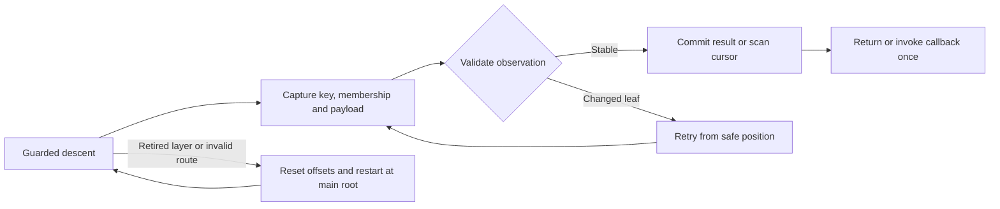
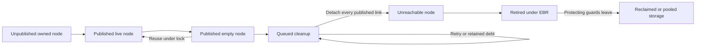

# Production-quality refinements for masstree 1.x

Generated by: GPT-6 Astra (max effort)

Reviewed 2026-11-09 against worktree revision
`5784ea64f4e33b8f4a3af434b53cc7ef41e7811a`, crate version `1.0.0`, Rust edition
2024.

This is a proposal, not an implementation change. The review covers the current
repository, not a downloaded copy of the published crates.io artifact. Source
links are relative to this file; symbol names are the navigation anchors when
line numbers move.

## 1. Recommendation and evidence

Keep the current trie of B+trees, 15-slot layout, optimistic readers, sealed
storage policies, and EBR reclamation. The next production-quality improvement
should make their contracts easier to use and harder to violate. A replacement
tree architecture would discard substantial completed work without evidence that
it solves the remaining problems.

The most useful next changes are:

1. Make public rustdoc accurate, executable, and complete enough to choose the
   right value, guard, scan, and update API.
2. Add ergonomic guarded and owned boxed-value iteration without changing
   existing iterator item types or adding unsafe dereferences to user code.
3. Collapse the remaining duplicate point-read implementations; share identity
   and publication rules while preserving measured fast paths.
4. Introduce small internal types and transition methods around validated
   observations, unpublished ownership, and committed mutations. Keep packed
   state in nodes and avoid a universal operation framework.
5. Make maintenance work, cleanup debt, and progress limits observable and
   recoverable.
6. Repair benchmark measurement and release evidence before using them to
   justify layout, inlining, or broader architectural changes.

The main gap is no longer the absence of an architecture or tests. It is the
distance between the implemented contracts, the public documentation, and the
evidence required to safely evolve those contracts after 1.0.

### 1.1 What is already complete

[SystemAudit.md §2.5](SystemAudit.md#25-remediation-status-2026-11-08) records
remediation of all of that audit's P0/P1 findings. Its original findings
describe an older baseline and remain in the file for historical purposes. They
must not be reported as current defects without reproducing them again.

The implementation-order table in
[ArchitectureProposals.md](ArchitectureProposals.md#implementation-order-v100-worktree)
and the current source agree on these substantial completed changes:

| Completed work | Current implementation to preserve |
| --- | --- |
| Shared descent, B-link traversal, and promoted-layer root resolution | [tree/traversal.rs](../src/tree/traversal.rs), including opportunistic parent-slot refresh |
| Shared validated scan machinery and compile-time direction | [range/scan_ctx.rs](../src/tree/range/scan_ctx.rs), [direction.rs](../src/tree/range/direction.rs), [helper.rs](../src/tree/range/helper.rs) |
| Shared generic/write-through insert driver and insert search | [insert_strategy.rs](../src/tree/generic/insert_strategy.rs), [search.rs](../src/tree/generic/search.rs) |
| Owning batch entries, a shared bulk pipeline, bounded `Extend` chunks | [batch.rs](../src/tree/generic/batch.rs), `Extend` in [generic.rs](../src/tree/generic.rs) |
| Entry leaf hints validated before mutation | [entry.rs](../src/tree/generic/entry.rs), hint use in [insert.rs](../src/tree/generic/insert.rs) |
| Raw-buffer suffix ownership, complete-live-set sizing, split reservation | [suffix.rs](../src/suffix.rs), [suffix_ops.rs](../src/policy/suffix_ops.rs) |
| Stack routes for ordinary removal; address-free deferred chain jobs | [remove.rs](../src/tree/remove.rs), [coalesce.rs](../src/tree/coalesce.rs) |
| Adaptive node-pool refill and TLS-destruction fallback | [node_pool.rs](../src/node_pool.rs) |
| Speculative, unpublished twig preparation with cleanup on abandonment | [layer.rs](../src/tree/generic/layer.rs), `PreparedLayer` |
| CI for tests, features, strict Clippy, Loom, and a Miri leak suite | [ci.yml](../.github/workflows/ci.yml) |

In particular, do not propose another forward/reverse scan rewrite, another
batch ownership redesign, or another raw `SuffixBag` conversion as new work. A
`LayerAnchor` remains an optional research direction, not an unfinished
prerequisite.

### 1.2 Fresh verification

Environment: Linux `x86_64-unknown-linux-gnu`,
`rustc 1.99.1 (58cf8f9c3 2026-10-13)`, Cargo 1.99.1. Cargo commands used
`--locked --offline` and `CARGO_TARGET_DIR=/tmp/masstree-proposals-target`. No
implementation files were changed to obtain these results.

| Check | Observed result |
| --- | --- |
| `cargo fmt --all -- --check` | Pass |
| `cargo test --lib` | 617 passed |
| `timeout 240s cargo test --tests` | 1,036 passed, 4 ignored; includes the same 617 library tests, so 419 additional integration tests passed |
| `cargo test --doc` | 14 ordinary examples and 3 compile-fail examples passed; 20 examples ignored |
| `RUSTDOCFLAGS='-D warnings' cargo doc --no-deps` | **Fails with four diagnostics**, listed in P01 |
| `cargo clippy --all-targets --all-features -- -D warnings` | Pass |
| `cargo check --all-targets --no-default-features` | Pass |
| `cargo test --lib --features sidecar-suffix,small-suffix-capacity` | 618 passed; this is the combined configuration, not independent coverage of every feature combination |
| `RUSTFLAGS='--cfg loom' timeout 180s cargo test --lib loom_tests` | 16 models passed; 617 ordinary tests filtered out |

The four ignored integration tests are the long mixed-workload, prefix
thundering-herd, extreme-contention, and 100-run stress cases. Their exclusion
is visible; their success is not implied by the aggregate result.

Logs for this review are
`/tmp/masstree-proposals-{lib,integration,doctest,doc,clippy,no-default,suffix-tests,loom}.log`.
They are temporary local evidence, not durable release artifacts. Reproduction
commands are more important than retaining those paths.

This review did **not** rerun the entire standalone failure corpus, Miri,
release-mode tests, native ARM tests, MSRV builds, or performance benchmarks.
The passing Loom tests model specific protocols, not a complete concurrent tree
or external suffix store. Historical Miri and benchmark results are credited as
historical evidence only. Green tests here are not a proof of absence of UB,
starvation, or semantic regressions.

### 1.3 Evidence labels and source size

Throughout this document, **observed** means a command was run in this review;
**source-confirmed** means the mechanism is visible in the current source;
**hypothesis** means measurement or a focused reproducer is still needed.
Proposed acceptance tests are future work, not tests claimed to exist already.

The source census found 103 Rust files and 39,872 physical lines under `src/`,
including comments, docs, and tests. Excluding paths whose names contain `test`
leaves 73 files and 26,079 physical lines, still including some inline tests.
There are 651 lexical `#[inline(always)]` occurrences. `benches/` contains 13
Rust files and 18,914 physical lines. These are maintenance-size indicators,
**not** measurements of executable size or wasted instructions.

## 2. Priorities and compatibility policy

Here, P1 means the next refinement series; P2 follows the contract and
verification work; P3 is conditional research. These priorities do not relabel
the historical audit or assert a newly reproduced memory-safety blocker.

| Proposal | Priority | Decision | UX / DX / AX benefit |
| --- | --- | --- | --- |
| P01: executable public contracts | P1 | Repair rustdoc and publish a canonical API guide | Users choose correctly; reviewers and agents can test the examples they read |
| P02: value and mutation API ergonomics | P1 | Add guarded/owned scan APIs; document current Entry semantics before adding conditional mutation | Safe boxed iteration and unambiguous concurrent update behavior |
| P03: remove remaining semantic duplication | P1, after characterization tests | Use one guarded point-read core and shared identity helpers | Fewer paths to understand, optimize, and repair |
| P04: internal ownership and validation capabilities | P2 | Introduce private types at protocol boundaries, one subsystem at a time | Local proofs replace repeated reasoning about raw pointers and booleans |
| P05: scan transition invariants and projections | P2 | Refine the existing engine, preserving its direction specialization | Consistent scan behavior and fewer unnecessary allocations |
| P06: maintenance progress and memory debt | P1 for contracts; P2 for behavior | Expose work outcomes and recover abandoned cleanup without stale pointers | Predictable operations and useful diagnostics under churn |
| P07: trustworthy performance and build-size evidence | P1 for harness correctness; P2 for tuning | Measure before changing inlining, layout, or dispatch | Defensible performance claims and smaller, understandable benchmarks |
| P08: verification and release contract | P1 | Add strict docs, supported-toolchain checks, corpus outcomes, and downstream compatibility fixtures | Reproducible releases and stronger regression detection |
| P09: documentation authority and contributor workflow | P1 | Reconcile historical/current documents and connect invariants to tests | Less contradictory context for humans and coding agents |

Preserve existing 1.x public names, signatures, trait bounds, associated types,
feature defaults, and documented semantics. In particular, changing
`RangeIter::Item`, removing low-level reexports, making `Entry` atomic, or
changing a public exhaustive error enum is not a cleanup-only patch. Additive
APIs also need downstream compile checks because new methods and trait
implementations can affect method resolution. These decisions follow the
distinctions in the
[Cargo SemVer guide](https://doc.rust-lang.org/cargo/reference/semver.html).

“Without breaking anything” is an acceptance constraint, not a guarantee that a
refactor is risk-free. Keep changes small, preserve observable behavior, require
targeted evidence, and roll back any optimization that fails its correctness or
performance gate. A confirmed soundness defect would need an explicit fix and
release decision rather than preservation of unsafe behavior for compatibility.

## 3. P01 — Make rustdoc an executable contract

### 3.1 Immediate documentation defects

The crate already has `#![deny(missing_docs)]`. Adding that lint again would not
address the problem: documented items can still have inaccurate contracts,
unusable examples, or broken links.

The strict public documentation build fails at these current locations:

| Location | Diagnostic | Proposed correction |
| --- | --- | --- |
| [leaf15.rs](../src/leaf15.rs), line 312, `prepare_value` | Public documentation links private `store_prepared_value_relaxed` | Explain the public preparation contract; put the internal link in private implementation documentation |
| [policy.rs](../src/policy.rs), line 648, `output_from_retire_ptr` | Link to private `ValueArray::update_in_place` | Describe the ownership provenance without exposing an unavailable public target |
| [optimistic_reads.rs](../src/tree/generic/optimistic_reads.rs), line 892, `get_ref` | Unresolved `Deref` link | Use the fully qualified standard-library link |
| [tree.rs](../src/tree.rs), line 213, `MassTree15` | `Vec<u8>` parsed as unclosed HTML | Use code formatting |

Do not suppress the diagnostics globally or build private docs to hide
public-doc failures. Add strict public `cargo doc --no-deps` to CI, initially
for default and all-feature configurations, plus no-default documentation if it
differs.

Twenty ignored doctests leave the primary scan APIs largely unchecked. Some
snippets lack setup; others retain invalid or unsafe usage. For example,
[ScanEntry's example](../src/tree/range/iterator/scan_entry.rs) calls
`ValuePtr::as_ref()` as though it were a safe ordinary reference accessor. Most
of these examples should become runnable with hidden imports/setup and explicit
`MassTree<u64>` or `MassTree15<String>` types. Use `no_run` only for code that
must compile but cannot sensibly run; reserve `ignore` for a documented
exceptional reason. Rustdoc skips ignored examples, whereas `no_run` still
compiles them.
[Rustdoc documentation-test guide](https://doc.rust-lang.org/rustdoc/write-documentation/documentation-tests.html).

### 3.2 Contracts that need correction or expansion

| Topic | Current source-backed issue | Required documentation |
| --- | --- | --- |
| Tree choice | `MassTree` is the inline alias; [tree.rs](../src/tree.rs) suggests arbitrary `Copy` types and raw pointers | `MassTree<V>` requires `InlineBits`; `MassTree15<V>` is the boxed choice for `String`, non-`Copy`, and non-`Clone` guarded use. Show actual supported primitives and a custom codec example |
| Boxed write-through | `get_ref` describes the gate as “V <= 8 bytes” | [policy.rs](../src/policy.rs) uses a closed primitive-type test. Size alone does not imply write-through or an owned snapshot |
| Guarded outputs | Some prose still describes raw outputs or only borrowed values | `ValueRef` can contain a borrow or an owned snapshot. State which operations clone, copy, allocate, or merely carry a handle |
| Iteration | [range/api.rs](../src/tree/range/api.rs) promises cloned values; `RangeIter::Item` contains `P::Output` | Inline output is `V`; boxed output is opaque `ValuePtr<V>`. Owned keys do not make boxed values owned |
| Entry | [entry.rs](../src/tree/generic/entry.rs) correctly warns about stale snapshots, then suggests write-through for atomic RMW | An atomic store does not make the preceding read/compute/store atomic. Document the snapshot contract prominently and remove the misleading implication |
| Concurrency | [lib.rs](../src/lib.rs) implies concurrent access requires explicit guard APIs | Convenience APIs create guards internally. Explicit guards amortize participation and control returned borrows; they do not enable concurrency by themselves |
| Progress | “Lock-free readers,” bounded locking, or retry-limit wording can imply an operation deadline | Readers do not acquire read locks, but can wait for dirty writers and retry. A local spin/retry budget is not a wait-free or wall-clock completion bound |
| Count | `len()` is approximate; `is_empty()` delegates to it | Both are observations during concurrent mutation, not synchronization or snapshot predicates; quiescent count is exact |
| Maintenance | A queue item can represent an entire sublayer; attempts can requeue or be abandoned | Distinguish attempted jobs, detached nodes, retired memory, and actually reclaimed memory. `flush`/`refresh` cannot force reclamation while other guards protect it |
| Errors and panics | `remove_with_guard` says only “If fails to remove”; internal insert still carries a historical error shape | Document invalid key length, foreign guards, user-code panics, retry exhaustion, and their scope. Do not promise a deadline from `RemoveError` |
| Internal claims | `LockGuard` is called zero-sized, but stores a pointer and `u32`; `InsertStrategy` claims forced inlining ensures identical machine code | Correct the statements. Separate design intent from layout assertions and measured code generation |
| Allocator feature | [README.md](../README.md) says `mimalloc` installs a global allocator | The library explicitly does not do so. Explain node allocation versus application-wide allocation and benchmark configuration |
| Version/support | README still says work is needed “before 1.0”; MSRV 1.92 is prose-only | Remove obsolete release framing; verify the promised MSRV and encode it in Cargo metadata and CI |

### 3.3 A public documentation structure worth maintaining

Use crate-level rustdoc as the canonical user guide. Keep README short and link
to it. Keep implementation proofs in module documentation and architecture
references, rather than mixing them into ordinary usage examples.

The guide should contain:

1. **Choose a tree and value type.** Inline `u64`, boxed `String`, and a
   non-`Clone` boxed value. Explain the sealed policy surface and the separately
   unsafe custom allocator extension point.
2. **Keys and ordering.** Arbitrary bytes, lexicographic order, empty keys, a
   256-byte maximum, embedded/trailing NULs, and the distinction between an
   8-byte ikey and full-key identity. Demonstrate big-endian encoding for
   unsigned integers; do not suggest that arbitrary native serialization
   preserves order.
3. **Ownership and guards.** A table of output types, cloning, lifetimes, and
   allocations. Show ending value borrows before `maintenance(&mut guard)`.
   Explain that guards delay reclamation and do not provide a transactional
   snapshot. Recommend short synchronous guard scopes around async application
   work.
4. **Mutations and concurrency.** Replacement versus conditional mutation;
   snapshot Entry behavior; remove errors; duplicate-key batch semantics;
   partial batch application on panic. Ordinary batch APIs validate keys before
   mutation, but `Extend` processes bounded chunks and can have completed
   earlier chunks when a later input fails.
5. **Scans.** Forward, reverse, prefix, mixed `next`/`next_back`, early
   stopping, and callbacks. State the supported concurrent-observation contract
   precisely. Do not promise a whole-range snapshot, atomic batch, or
   consistency stronger than the actual per-entry validation protocol.
6. **Memory lifecycle.** Guard lifetime, retirement, maintenance cadence,
   pending/deferred/abandoned coalesce counters, TLS pool retention, and
   behavior of panicking value destructors.
7. **Supported environments and features.** Tested targets, required atomic
   capabilities, MSRV policy, default `debug-print`, both suffix configurations,
   tracing, allocator selection, and `no-prefetch`.

Recommended example matrix:

| Example | Positive behavior | Companion regression or compile-fail case |
| --- | --- | --- |
| Inline basic map | Insert/get/remove with `MassTree<u64>` | Invalid-length input boundary |
| Boxed ownership | `get`, `get_with_guard`, `ValueRef::into_owned` | Borrow cannot escape guard/tree; positive equivalent still compiles |
| Non-`Clone` value | Guarded lookup and callback scan | Convenience clone-requiring API has an intentional bound |
| Range and prefix | Correct bounds, reverse, prefix and early exit | Same-ikey/trailing-NUL keys and maximum-length prefix |
| Entry | Snapshot semantics in a simple sequence | Two independently captured entries demonstrate the stale-update contract deterministically |
| Batch | Duplicate full keys: last input wins | Order of returned old values is documented rather than assumed to match input order |
| Maintenance | Release borrows, then flush/refresh | Another pinned guard prevents a reclamation guarantee |
| `InlineBits` | Valid round trip and representation | Panic before publication leaves existing tree usable |

Do not turn all examples into `compile_fail` to make CI green. A negative
example can fail for the wrong reason; pair it with a positive example and,
where practical, a diagnostic-specific UI test.

**Acceptance:** strict public docs pass; public usage examples compile/run under
the appropriate feature sets; remaining ignored examples each have a reason;
docs agree with source signatures and tests; any newly included Markdown guide
is added to the package include list. This proposal changes documentation and
checks before changing runtime behavior.

## 4. P02 — Improve public value and mutation ergonomics additively

### 4.1 Boxed-value scans are the clearest API gap

Current guarded point reads return `ValueRef<'g, V>`, but range iteration,
values iteration, guarded first/last, and several callback/collection paths
still return `P::Output`. For `BoxPolicy`, that is `ValuePtr<V>`. It is an
opaque non-owning handle with no safe dereference. That is materially safer than
the old unsound API, but it leaves ordinary boxed iteration awkward and
contradicts the “cloned values” documentation.

**Decision:** add a guarded iterator family yielding
`ScanEntry<ValueRef<'g, V>>`, plus an owned adapter requiring `V: Clone`. Names
such as `range_guarded` and `range_owned` are design candidates, not existing
APIs. Use the same vocabulary for iter/all-values/first/last and collections.
Keep the current `range`, `RangeIter`, and `P::Output` APIs unchanged in 1.x;
label them accurately as policy-output APIs and point ordinary users to the
ergonomic family.

Implementation constraints:

- Build on the existing validated scan kernel and its emitter/projection
  boundary. Capture the primitive atomic snapshot or protected boxed allocation
  with the correct validation ordering.
- Tie borrowed outputs to the actual protecting guard and verify its collector.
  A copied `ValuePtr` by itself is not a lifetime proof.
- Do not implement the new iterator by scanning keys and calling `get` for each
  key: that adds descent work and can pair a scan observation with a later
  lookup.
- Do not add safe `Deref` to `ValuePtr`, reconstruct arbitrary `&V` for
  write-through values, or require `Clone` for all guarded boxed iteration.
- Preserve callback-scoped references for the existing allocation-avoiding
  `scan_ref` family. A reference into a temporary atomic snapshot must not
  escape the callback.

**Acceptance:** non-`Clone` boxed values are iterable in safe code; guarded
borrows cannot escape; owned results survive tree/guard destruction; primitive
updates remain atomic; Miri covers replacement/removal and output lifetimes; the
full scan matrix in §13 passes; no second descent is introduced per item.

### 4.2 Entry must have one understandable concurrency story

`Entry::new` captures a classification, value snapshot, and optional leaf hint.
Hints are revalidated under lock before fast mutation and fall back correctly
when stale. This is useful and already optimized. It is not an atomic entry
transaction.

An occupied `and_modify` can compute from an old value. A vacant entry can
overwrite a key inserted after classification. These are already described in
[entry.rs](../src/tree/generic/entry.rs), so silently changing `or_insert` or
`and_modify` semantics in a cleanup would be inappropriate.

**Decision:** first correct the docs and add deterministic contract examples.
Then add a separate `insert_if_absent` operation if concurrent conditional
insertion is a supported use case. Its lookup and decision must occur under the
relevant leaf lock, with the same full-key revalidation and split/layer fallback
as ordinary insertion.

Treat general conditional replacement as a separate design, not a method
casually named `atomic_entry`. Define whether comparison means value equality,
observed identity, or a generation, how ABA is handled, and what happens to the
supplied value on conflict. Prefer a non-callback operation with an explicit
conflict result for the first version. Do not run arbitrary user callbacks under
structural locks or transparently repeat `FnOnce`/side-effecting callbacks
during OCC retries.

Keep existing Entry behavior in 1.x. A future redesign to provide
standard-map-like atomic Entry semantics belongs in an explicitly versioned API
decision, with contention and reentrancy evidence.

### 4.3 Smaller composability improvements

[KeysIter and ValuesIter](../src/tree/range/iterator/adapters.rs) delegate
`next` and `size_hint` but do not implement `DoubleEndedIterator`, even though
`RangeIter` does. Add delegating reverse support, with mixed-direction tests,
after checking downstream method resolution. Avoid `ExactSizeIterator`:
concurrent mutation and approximate `len` do not support that promise.

`RangeIter` also has an inherent `for_each` with a visitor signature and
early-stop count, which shadows the standard iterator method. Preserve it for
compatibility, document the distinction, and introduce a clearly named visitor
entry point if needed. Do not multiply synonyms across all APIs: document one
preferred visitor route and retain existing thin aliases.

Feature defaults, `MassTree` alias selection, public low-level exports, existing
`BatchStats` fields, and output ordering stay stable. Public helper removal is
not how to reduce runtime code bloat.

## 5. P03 — Remove semantic duplication while preserving specialization

### 5.1 Canonical guarded point-read core

[optimistic_reads.rs](../src/tree/generic/optimistic_reads.rs) has 917 physical
lines and [get_guarded.rs](../src/tree/generic/optimistic_reads/get_guarded.rs)
has 472. File length alone is not a defect, but both contain single-layer and
multi-layer read loops. `get_ref` still uses `get_impl_single_layer` /
`get_impl_multi_layer`, while `get_with_guard` uses another family. The comment
justifying separation describes obsolete public return types: both public
guarded APIs now return `ValueRef`.

**Decision:** characterize `get_ref` and `get_with_guard` over both policies and
all key shapes, then make the former a compatibility wrapper around one
canonical guarded lookup implementation. Keep the single-layer specialization,
twig fast path, prefetch behavior, and optional Entry hint capture where they
measurably help. `get` should remain an owned conversion over the same core.

The core should distinguish **found validated output**, **validated absence**,
**retry current position**, and **restart from the main root**. A null child or
retired cached root is not automatically “not found.” Do not obscure these
distinctions with `Option` plus unrelated booleans.

For `contains_key`, evaluate a membership projection that avoids value copying
or decoding while still validating the active slot and full key. This is a
performance hypothesis, not an instruction to delete the value-state checks that
prevent false positives during conversion/removal.

**Acceptance:** equivalent results and guard behavior across the existing API
families; deterministic deleted-layer/slot-reuse tests; negative reads validate
correctly; Miri and relevant Loom models; no throughput or tail-latency
regression on short keys, suffixes, promoted layers, misses, and hot updates.
Delete the redundant loop only after this gate.

### 5.2 Other duplication: share the rule, not every loop

| Area | Source evidence | Proposed boundary | What must remain distinct |
| --- | --- | --- | --- |
| Full-key classification | Insert's shared unrolled search, point lookup's matcher, and remove's scalar matcher | Common classification/comparison helpers for terminal, suffix, and layer cases | Operation outcomes, hot search layout, and lock/retry decisions |
| Leaf advancement | [generic.rs](../src/tree/generic.rs) advancement helpers and shared [traversal.rs](../src/tree/traversal.rs) | Share stable successor observation and explicit restart outcomes where contracts match | Scan resume rules, write lock ownership, and GC hop budgets |
| Root construction | Four leaf/internode × main/layer helpers in [root_creation.rs](../src/tree/split/root_creation.rs) | Common unpublished internode initialization | Main-root atomic publication versus layer promotion/parent-slot refresh ordering |
| Private insert errors | [tree.rs](../src/tree.rs) and [insert.rs](../src/tree/generic/insert.rs) retain historical result plumbing | Remove genuinely unreachable private error propagation after call-site proof | Public `InsertError` compatibility and real panic/corruption diagnostics |
| Leaf constructors and forwarding traits | [leaf15.rs](../src/leaf15.rs), [leaf_trait.rs](../src/leaf_trait.rs) | One internal initializer and removal of truly private unused scaffolding | Existing public wrappers, traits, bounds, and layout |
| Scan entry points | Several visitor/batch aliases already delegate to one driver | Canonical documentation and shared projections | Callback lifetime, early stop, reference versus copied output |
| Batch utilities | [batch_utils.rs](../src/tree/batch_utils.rs) includes collecting wrappers and heuristic statistics | Describe allocation and heuristic limitations; optimize privately only if measured | Existing helper signatures and observable statistics |
| Benchmark workloads | Repeated per-map setup and loops in large bench files | Shared workload generation, timing protocol, and static map adapters | Each map's guard, reclamation, and synchronization requirements |

In particular, `BatchStats::estimated_leaves` is based on ikey groups, not
actual tree occupancy or promoted sublayers. Document it as a heuristic; a new
precise metric needs a distinct contract. Do not silently reinterpret a public
statistic while calling the change deduplication.

Avoid a universal search/insert/remove/scan state machine, dynamic dispatch on
every operation, or a broad trait hierarchy merely to reduce line count. Share
pure decisions and narrow protocol primitives; keep operation-specific
sequencing visible.

## 6. P04 — Make ownership and validation boundaries explicit internally

The most valuable architectural refinement is a clearer boundary between
**observing a node**, **owning unpublished storage**,
**holding a node's mutation lock**, and **retiring an unreachable object**.
These facts currently recur across raw pointers, booleans, tags, comments, and
`unsafe` blocks.

The project already has useful pieces: `LockGuard`, `ValueRef`, `RetireHandle`,
`SlotKind`/`SlotState`, `PreparedLayer`, `ScanPosition`, and `ScanSnapshot`.
Extend their discipline; do not introduce a second representation of the same
slot state or claim that every current flag needs an enum stored in the node.

### 6.1 Proposed private capabilities

| Capability | Fact it should establish | Initial application |
| --- | --- | --- |
| Guarded node view | Pointer kind and lifetime are tied to a verified collector guard | Shared traversal and split propagation |
| Validated slot observation | Leaf, permutation membership, full-key identity, and loaded payload were checked together | Point-read consolidation and scan projections |
| Locked node/slot view | The lock belongs to this node, with required post-lock identity checks complete | Update/remove helpers; prevents passing an unrelated `LockGuard` as a token |
| Unpublished allocation owner | Storage is exclusively owned and not reader-visible; abandoning it cleans it up | Suffix initialization, new roots, prepared split/layer nodes |
| Pending value owner | A boxed allocation is either still caller/preparation-owned or has been transferred exactly once | Insert/batch unwind paths and displaced-value retirement |
| Published mutation phase | Past the dirty/publication boundary, completion is mandatory and user code cannot unwind | Split propagation and layer conversion |

These are candidate private abstractions, not a request to expose raw-node APIs.
Start with one boundary and measure object size, generated code, and ergonomics
before expanding. A zero-cost wrapper must be demonstrated, not declared.

### 6.2 Rules the architecture must express

- EBR protection proves lifetime, not node kind, current membership, full-key
  identity, or exclusive mutation. Each additional claim needs validation.
- A leaf lock does not make a published suffix buffer exclusively owned.
  `assign_init`, growth, and reallocation require unpublished/exclusive storage.
  Tighten call-site proof language around
  [suffix_ops.rs](../src/policy/suffix_ops.rs); a version value that looks
  “unpublished” is not independently an ownership proof.
- A `P::Output` handle can denote caller-owned prepared storage, tree-owned
  storage, or retired storage protected by a guard. Identical bits do not make
  those ownership states interchangeable.
- User `InlineBits` encoding/decoding, cloning, comparison, callbacks, and
  `Drop` need explicit panic boundaries. Preserve pre-encoding before
  destructive mutation and the existing abandonment cleanup in `PreparedLayer`.
- The unsafe custom allocator contract already requires non-null initialized
  nodes and **no unwind** from allocation. Keep that requirement explicit. After
  `mark_split` and publication, retry exhaustion or cancellation cannot abandon
  an incomplete structural mutation.
- Preserve actual memory-model reasons for atomics. Some pointer loads are
  `SeqCst` for the reclamation protocol; replacing them with Acquire because an
  x86 benchmark passes is not a valid optimization.
- [PropagationContext](../src/tree/split/propagation_context.rs) extends
  lock-guard lifetimes under EBR protection. A guarded-node capability can
  concentrate that proof, but deleting the cast alone is not a substitute for
  preserving lifetime and lock ownership.

Review local `unsafe` proofs alongside this work. For example,
`propagation_loop` in [propagation.rs](../src/tree/split/propagation.rs) forms
an internode reference from an erased parent pointer without an adjacent
`SAFETY` explanation. Its proof must account for non-nullness, kind,
initialization, and guarded lifetime, not merely say “parent is valid.” This is
a documentation/proof gap identified from source, not a reproduced claim of UB.

### 6.3 Version repetition deserves a model, not an assumption

`NodeVersion` has finite version fields: bits 3–27 contribute to the mutation
version, and `has_changed` compares snapshots after masking the effect of a
clean lock. A reader can be delayed while many mutations occur. EBR prevents
reclamation but does not prevent version values from recurring.

**Decision:** add a reduced-counter model that includes the actual
slot/permutation/payload protocol and a paused reader across wraparound; audit
stale Entry hints separately because they perform additional identity checks.
Existing hint tests already exercise version repetition, which is useful but not
a full OCC wraparound proof. Determine whether the protocol tolerates the
repeated version or needs a change before promising unbounded-reader safety from
version equality.

This is a proof obligation, not a reproduced current failure. Do not immediately
widen `NodeVersion`: that affects layout, atomics, code generation, and
potentially the public representation. Any such proposal must follow the model
and include size/offset assertions and a migration/performance assessment.

**Acceptance for P04:** private changes preserve layouts and public APIs; each
new capability has a narrow constructor and consumption rule; panic/drop
counters and Miri verify ownership; Loom models the changed publication rule; no
new allocation or dispatch enters a hot path without measurement.

## 7. P05 — Refine the existing scan machine

The direction-generic scan refactor is already complete. Its remaining
complexity is a product of `ScanState`, eight packed flags, an optional
snapshot, nullable position, cursor mode, layer stack, and frontend exhaustion
state. Merely having an enum named `ScanState` does not encode all legal
combinations.

**Decision:** add transition methods around the current representation. Examples
are preparing descent, installing an emit-ready snapshot, committing an emitted
cursor, requesting a local retry, restarting at the main root, and marking both
iterator directions exhausted. Keep forward/reverse navigation in `Direction`
and its existing specialized implementations.

First write down and test these invariants:

1. An emit-ready state must have a payload validated for the represented key and
   position.
2. A retry must preserve the last committed full-key cursor and the correct
   duplicate filter; an uncommitted observation must not advance it.
3. A retired cached layer root causes the appropriate fresh descent and
   key-offset reset, not a false end-of-range.
4. Callback side effects occur only after validation and must never be replayed
   merely because the scan retries.
5. Mixed forward/backward iteration shares a crossing boundary; once exhausted
   it stays exhausted in both directions.
6. Synthetic layer-bound cursors cannot be confused with real 9-byte or 17-byte
   keys. Length, offset, and sentinel mode must agree at the 256-byte boundary.

Use a discriminated temporary payload if it reduces invalid combinations, but
measure its stack/register impact. Keep stable node layouts. Do not replace all
flags with a heap-allocated or dynamically dispatched state-machine framework.

### 7.1 Projection and allocation opportunities

`ValuesIter::next` currently calls `RangeIter::next` and discards its owned key,
so values-only iteration still constructs a `Vec<u8>` per yielded key.
`KeysIter` also follows the generic payload path. The callback engine already
has more selective behavior, including full-key bound handling where required.

Add iterator projections through the same scan driver: owned key, guarded value,
owned value, key-and-value, and membership where useful. A values projection
still needs cursor/key information for bounds, progress, duplicate avoidance,
and layer transitions; eliminating the exported key allocation is not permission
to skip full-key comparisons.

`LayerStack` keeps six frames inline and spills for deeper keys. Inspect whether
repeated deep traversal allocates after the spill empties; retain/reuse spill
capacity only if measurements justify the iterator-footprint tradeoff. Do not
put 32 full frames in every iterator merely because maximum depth is bounded.

**Acceptance:** allocation counters distinguish owned-key iteration from
values-only and callback scans; all scan families pass the same `BTreeMap`
model; mixed-direction exhaustion is fused; maximum-depth, promoted-layer,
full-prefix and NUL cases remain covered; callback reentrancy and early stop
remain correct; object sizes and forward-only initialization cost are measured.

## 8. P06 — Make maintenance progress and memory debt operationally useful

### 8.1 Source-confirmed behavior

[CoalesceQueue](../src/tree/coalesce.rs) has active/deferred chain and sublayer
queues. Chain jobs carry an ikey bound; sublayer jobs carry a route. This
already avoids storing an unprotected raw leaf pointer across maintenance calls.

`process_all` drains deferred jobs, takes a queue-length budget, and attempts
jobs. `process_batch` limits attempts after also draining deferred jobs. A job
can be stale, requeued, or represent an entire sublayer tree. The returned count
is therefore not “nodes freed,” and the limit is not a fixed amount of CPU work
or reclamation.

After `MAX_REQUEUE_COUNT` is exhausted, jobs are abandoned. `requeue_chain`
explicitly leaves the leaf's queued bit set because it has no safe pointer with
which to clear it. Reuse or tree destruction clears the state. Thus a
delete-heavy workload that does not reuse the relevant keys can retain cleanup
debt despite later quiescence. This is a source-confirmed retention policy, not
a newly demonstrated UAF.

The single-call retry fix is present. However, concurrent maintenance callers
share the deferred queues: one caller can move another caller's deferred work
back to an active queue. Whether the intended “one attempt per maintenance call”
policy should hold globally needs a model and a stated contract; the local
queue-length budget alone is not a per-job generation.

### 8.2 Chosen design direction

First correct public terminology and document the existing `pending_coalesce`,
`coalesce_deferred`, and `coalesce_abandoned` counters. Add an outcome-rich
maintenance API alongside the old count-returning methods. Candidate outcomes
are attempted, stale/skipped, detached, deferred, abandoned/debt, and remaining
work. Keep “retired” separate from “reclaimed”; the latter cannot be inferred
from successful unlinking or `guard.flush()`.

Second, make exhausted cleanup **recoverable**, using an address-free debt
mechanism. Retain a bounded/backed-off route or bound, or schedule a resweep
with a generation. Never recover by resurrecting old raw pointers. Define
coalescing/deduplication so recovery does not grow an unbounded job queue.

Third, specify maintenance budgets. A job budget can be hard; a time or
node-visit budget is normally soft across an indivisible structural commit. A
sublayer removal cannot stop halfway through detaching/retiring its nodes.
Expose that limitation rather than advertising a strict latency deadline.

For concurrent drains, evaluate a single maintenance-drain owner or
generation-tagged scheduling after measuring contention. A maintenance-local
coordinator may be reasonable; a new global lock on ordinary lookups/inserts is
not. Enforce lock order explicitly: ordinary chain coalescing uses leaf →
parent, whereas sublayer collection holds parent leaf and uses nonblocking
acquisition of sublayer nodes to avoid a cycle.

### 8.3 Memory and shape are separate concerns

Report or measure four categories separately: live sparse nodes,
queued/abandoned empty nodes, retired objects held by guards, and free nodes
retained in TLS pools. One RSS number cannot identify which policy to change.

The current cascade intentionally preserves live unary internodes and their
heights; only empty structures can be removed under the established protocol. Do
not reintroduce naive root contraction or online merge as a memory optimization.
If measured long-lived sparse structure is a product problem, evaluate an
explicit exclusive rebuild/compaction operation before designing concurrent
merging.

**Acceptance:** barrier-driven tests with bounded watchdogs cover contention
followed by quiescence, concurrent maintenance callers, stale routes, reuse,
promoted sublayers, and maximum depth. Counting allocators and drop counters
show debt eventually drains under the chosen contract. Existing lock order,
unlink-before-retire, and no-stale-pointer rules remain intact. A long-lived
guard test demonstrates why retirement does not imply immediate reclamation.

## 9. P07 — Make performance and code-size decisions measurable

### 9.1 Repair measurement before tuning

Two important benchmark problems remain visible in current source:

- [bench_utils.rs](../benches/bench_utils.rs) provides warmup barriers and
  measurement fences, but these do not start or stop Divan's timer. Calls to
  `run_concurrent` inside measured closures in
  [concurrent_read_write.rs](../benches/concurrent_read_write.rs), and repeated
  thread setup in [high_impact.rs](../benches/high_impact.rs), include spawn,
  warmup, barriers, and join in the measured envelope. A counter naming only
  steady-state operations does not remove that time.
- [mttest.rs](../benches/mttest.rs) computes and prints `check_errors`, but
  `ThreadResult` does not carry them into a failing process status. A checked
  run that prints errors must not be accepted as a successful performance
  result.

Use persistent workers with an explicit setup → warmup → synchronized
measurement → stop → join → validation protocol, or a benchmark API that
measures a clearly defined worker interval. Keep setup-cost benchmarks
separately named if startup latency matters. Add a forced-failure harness check
proving that correctness errors produce a nonzero exit status.

The custom harness already emits JSON metadata; extend it rather than inventing
a second output format. Record commit, toolchain, features, allocator/global
allocator, machine and CPU topology, affinity/NUMA policy, seed, key/value
representation, cardinality, operation mix, guard/maintenance cadence, warmup,
and measured interval. Generate README comparisons from compatible runs with
explicit competitor configuration. Do not carry forward a historical ratio
allegation without recomputing the current table.

### 9.2 Reduce generated code only where evidence supports it

The 651 `inline(always)` annotations and generic axes (`P`, allocator, insert
strategy, direction, visitor/projection) justify investigation, not blanket
removal. Share cold, policy-independent work such as diagnostics, retry
accounting, formatting, and allocation sizing where possible. Preserve static
specialization for representation and direction on the hot path.

Measure:

| Dimension | Workloads / artifact |
| --- | --- |
| Throughput and latency | Point hit/miss; replace; split-triggering insert; remove+maintenance; forward/reverse/prefix scans; hot-key contention; p50/p99/p99.9 where the harness supports valid sampling |
| Allocation and retention | Boxed non-`Clone`, primitive write-through, short/suffix/max-depth keys, values-only iteration, delete-heavy churn, thread churn, long-lived guards |
| Build and code size | Clean and incremental build time, `.text` size, relevant symbol/assembly inspection, realistic downstream combinations of value types |
| Footprint | Leaf/internode size and offsets, iterator/context size, stack usage at maximum depth, TLS pool retention |
| Configuration | Default/no-default, suffix variants, prefetch toggled, node allocator versus application global allocator, native targets actually supported |

Use both the repository's optimized profile and a small downstream crate using
ordinary release settings. Cargo ignores profile settings from dependencies, so
this crate's fat LTO, codegen-unit, and `panic = "abort"` settings do not
establish downstream performance or unwind behavior.
[Cargo profile reference](https://doc.rust-lang.org/cargo/reference/profiles.html).

Compare matched before/after builds with repeated runs and reported variance.
Define an acceptable regression threshold from the harness noise and workload
priorities before deciding to merge. Do not advertise an arbitrary percentage
improvement or use noisy shared-runner throughput as the sole CI gate.

### 9.3 Architectural options explicitly deferred

| Option | Revisit only if | Why it is not the default next change |
| --- | --- | --- |
| Stable `LayerAnchor` allocation | Profiling shows meaningful root-climb/refresh cost after current caching | Adds allocation, indirection, ownership and reclamation states |
| Different WIDTH / node layout / SIMD routing | Representative routing and cache data justify the change on supported targets | Changes split geometry and layout; previous experiments were mixed |
| Wider version word | A wraparound model or reproducible failure requires it | Layout/public representation and atomic costs need evaluation |
| Online node merging/root contraction | Sparse live-node retention remains material after cleanup improvements | Reopens height, parent, B-link, and retirement protocols |
| Dynamic policy framework | Real extension demand outweighs static-dispatch costs | Current policies are intentionally sealed and optimized |
| Crate-wide typestate rewrite | Incremental capabilities prove a compelling benefit | Large generic machinery can worsen code size, diagnostics, and agent navigation |
| General key-codec subsystem | User requirements go beyond documented byte encoding | Ordered encoding, signed/floating semantics, and compatibility deserve a separate design |

## 10. P08 — Strengthen verification and the release contract

### 10.1 Extend existing CI, do not replace it

Current CI already covers strict Clippy, fmt, default tests, doctests, several
feature builds, Loom, and Miri leak tests. The next gaps are:

| Gap | Proposed gate | Cadence |
| --- | --- | --- |
| Public rustdoc warnings are not gated | `RUSTDOCFLAGS='-D warnings' cargo doc --no-deps`, relevant feature variants | Every PR |
| MSRV is prose-only | Test promised 1.92 support, including a compatible dependency resolution; set `rust-version` only after verification | Every PR for supported library configurations |
| Feature jobs mainly compile | Run relevant value/suffix/range regressions independently under sidecar, small suffix, no-default, and selected combinations | PR matrix, broader scheduled matrix |
| Debug/release differences | Execute regression suites in release as well as debug | Release candidate and scheduled |
| Standalone regressions are outside normal CI | Outcome manifest and isolated subprocess runner for selected `failures/` cases | Small PR set; broader scheduled set |
| Weak-memory/target evidence | Native ARM correctness tests if ARM is claimed; relevant models and cross-target build checks | Dedicated runner/scheduled |
| Safe API ownership coverage | Expand Miri beyond leak tests when a change touches guarded outputs, callback references, suffix ownership, or unwind paths | Targeted PR jobs and scheduled |
| Long stress tests are ignored | Explicit time-bounded execution, seed/round reporting, retained failures | Scheduled, not every quick PR |
| Published compatibility | External consumer fixtures and SemVer comparison to the exact published 1.0.0 baseline | API PRs and releases |
| Package differs from checkout | Package listing, package verification, and consumer build against packaged contents | Release gate |
| Benchmark validation can print-only fail | Forced check failure must exit nonzero | Harness changes |

`rust-version` is Cargo's declaration of supported Rust, and should be backed by
actual verification rather than copied from README. See the
[Cargo Rust-version reference](https://doc.rust-lang.org/cargo/reference/rust-version.html).
This review did not validate 1.92, so it does not recommend raising or lowering
the promise without that test.

### 10.2 Give the failure corpus explicit expected outcomes

The directory name `failures/` is historical. Its
[README](../failures/README.md) now describes regression use, while repository
instructions still call the corpus intentionally failing. Some tests should pass
after fixes, some are compile-fail demonstrations, and some require special
tools or remain dangerous.

Add a small manifest with case ID, finding, command, required
features/toolchain, timeout, expected exit/diagnostic/sentinel, and whether it
is safe in routine CI. Run every executable case in a disposable process with an
external timeout and a target directory outside the repository. Never treat
“exited nonzero” as sufficient proof of the intended compile-fail or panic;
distinguish expected evidence from a missing dependency or unrelated compile
error.

Prefer extending these existing reproducers over a new random stress test for
each refactor. Promote small deterministic cases into ordinary tests where
appropriate while retaining traceability to the original finding. Do not weaken
assertions to make a corpus runner green.

### 10.3 Test the observable protocol, not its current spelling

For sequential operations, compare full keys, values, length at quiescence, and
ordered iteration with `BTreeMap`. For concurrent changes, use barriers/test
hooks and watchdogs to force the transition of interest. Do not use sleep
duration as the primary synchronization mechanism.

For ownership, use nontrivial drop counters and Miri. For allocation claims, use
counting-allocator deltas. For weak-memory claims, include actual
payload/tag/permutation publication in a model: a passing mutex or version-only
model cannot prove a suffix, scan, or ownership protocol it does not represent.

The existing Loom suite has useful node-version, inline-word, internode, hint,
root-refresh, and scan models. Keep their scope explicit. Extend a model only
when the production protocol under review is represented, and explain any
abstraction and remaining gap.

### 10.4 Release metadata and downstream behavior

Add a concise changelog and support policy describing SemVer, MSRV changes,
supported targets, guard/progress semantics, feature compatibility, and how to
report a safety issue. Check that public examples run from the packaged crate:
[Cargo.toml](../Cargo.toml) currently includes only `src/**/*`, Cargo.toml,
LICENSE, and README.md, so future rustdoc `include_str!` guides outside `src`
require packaging changes.

Use [scripts/bump_version.py](../scripts/bump_version.py) as a version-edit
helper, not a release proof. A release candidate needs package verification,
docs, compatibility checks, and relevant evidence before publishing. This
proposal does not request publishing another version.

## 11. P09 — Give users, contributors, and agents one current source of truth

The repository has several large documents with different baselines:
[ARCHITECTURE.md](ARCHITECTURE.md), [SystemAudit.md](SystemAudit.md),
[ArchitectureProposals.md](ArchitectureProposals.md),
[ARCHITECTURERefined.md](ARCHITECTURERefined.md), [Findings.md](Findings.md),
and [AGENTS.md](../AGENTS.md). The refined architecture is a replacement
proposal; it is not a description of the current implementation. Historical
proposals contain original defects below completion summaries. AGENTS still
repeats repaired ownership, OCC, suffix, and tooling problems.

**Decision:** define document roles and reconcile them in a separate
documentation change:

| Document | Authoritative role |
| --- | --- |
| Crate rustdoc | Supported API contracts and executable usage |
| README | Short introduction, installation, accurate feature summary, linked reproducible performance evidence |
| ARCHITECTURE.md | Current implemented protocols and navigation, verified against source |
| SystemAudit.md | Historical findings plus a prominent current status index and regression links |
| Historical proposals / refined architecture | Archived decisions or conditional research, each marked with baseline and status |
| AGENTS.md | Concise workflow, current invariants, source map, and required validation; no duplicated stale bug catalog |
| This proposal | New, source-checked refinement backlog for the reviewed 1.0.0 worktree |

Give invariants stable identifiers, for example `OCC-PUBLISH`, `SLOT-IDENTITY`,
`LAYER-ROOT`, `UNLINK-BEFORE-RETIRE`, `SUFFIX-EXCLUSIVE`, and `SCAN-COMMIT`. For
each, link the implementation owner, a short proof, and the regression/model
that exercises it. An agent should be able to find the relevant rule without
inferring whether a historical paragraph was superseded.

Keep `justfile` as the contributor command entry point unless concrete
complexity warrants another tool. It already has real test commands; do not add
a task-runner framework for its own sake. Publish quick, subsystem, and release
check groups so contributors can run the right evidence without either skipping
it or launching the whole corpus.

Tracing should follow the same contract discipline. The existing optional
`init_tracing` configures file output, attempts global subscriber installation,
and discards the installation error while retaining its worker guard. Document
that behavior. Prefer library events that integrate with an application's
subscriber; an additive events-only feature and a fallible initialization helper
can improve integration while preserving the current `tracing` feature and
`init_tracing` signature. Do not automatically install a subscriber on tree
construction.

**Acceptance:** a search for each repaired finding leads first to its current
status; public docs and architecture agree on output types and progress;
commands point to real targets; every protocol-changing PR updates the relevant
invariant and evidence link. AX improves through concise, testable context
rather than more speculative prose.

## 12. State-machine inventory

This inventory covers the stateful protocols in production `src/` and the
supporting benchmark/test/release workflows. A state machine here means state
carried across an operation, retry, publication, callback, or lifetime boundary.
Ordinary pure comparisons and simple bounded loops are not listed as separate
machines.

Several machines already have enums. They are included because the meaningful
state is often the product of an enum with flags, pointers, ownership, and
external state. The inventory is a source-level coverage map, not a formal proof
that every reachable interleaving has been enumerated. The gates below describe
evidence required when changing a machine, not blanket claims about existing
coverage.

### 12.1 Observation, representation, and publication

| ID and owner | Encoded states and transitions | Decision / invariant / gate |
| --- | --- | --- |
| S01 — [NodeVersion / LockGuard](../src/nodeversion.rs) | Unlocked stable → locked clean → insert-dirty or split-dirty → release with version change. Deleted, root, and node-kind bits add orthogonal state. A clean lock alone does not invalidate readers; dirty state does. | **Keep packed representation.** Document mark/publish/unlock ordering and finite version repetition. P04's reduced-counter model must include payload and permutation, not just counter equality. |
| S02 — [Lock/backoff](../src/nodeversion.rs), [bounded locking](../src/nodeversion/bounded.rs) | Failed CAS/try-lock → spin/backoff → retry/yield; stable reads wait for dirty writers. Bounded acquisition can be retried indefinitely by an outer loop. | **Clarify progress.** Name budgets by scope; test local timeout versus operation retry behavior. Never equate bounded spins with bounded end-to-end latency. |
| S03 — [Point-read OCC](../src/tree/generic/optimistic_reads/get_guarded.rs), [read variants](../src/tree/generic/optimistic_reads.rs) | Capture stable version → read membership/key/tag/payload → validate → return value or absence; changed observations retry. Structural invalidation may require a main-root restart. | **Consolidate under P03.** Positive and negative results both need validation. Model transient cleared values and layer conversion; ensure no branch turns retry into absence. |
| S04 — [Guard/collector association](../src/tree/generic.rs), [protected traversal](../src/tree/traversal.rs) | Tree guard creation/verification → protected root/child/parent loads → guard refresh/drop. A pointer's protection domain is carried implicitly by the caller. | **Type selected internal views.** Verify the guard belongs to the tree; preserve seize's load/retirement ordering. Test foreign guards and guarded output lifetimes. |
| S05 — [Permuter / AtomicPermuter](../src/permuter.rs) | Packed active prefix and free tail → allocate/move/remove/reorder slot → publish new permutation. Physical slot identity differs from logical position. | **Keep compact encoding.** Centralize membership checks and full-key ordering assertions. Test all supported widths, release-mode public preconditions, and slot reuse. Slot zero can retain a routing bound even when inactive. |
| S06 — [Leaf slot lifecycle](../src/leaf15.rs), [policy views](../src/policy.rs) | Inactive/prepared → terminal inline or suffix value → layer conversion or removal → reusable slot. `keylenx`, value/tag, suffix metadata, and permutation jointly encode state. | **Use existing derived SlotKind/SlotState plus validated/locked views.** They are observations, not an additional stored lifecycle enum. Conversion must be dirty before clearing/reinterpreting a published slot. |
| S07 — [Value ownership / retirement](../src/policy.rs), [batch ownership](../src/tree/generic/batch.rs) | Caller-owned value → prepared output → tree-owned allocation → displaced/taken output → deferred retirement → reclaim. Inline values skip heap ownership stages. | **Type pending ownership incrementally.** Handle copying does not transfer allocation ownership. Drop-counter/Miri gates must cover overwrite, duplicate batches, failed preparation, and unwind. |
| S08 — [Inline tag/bits](../src/policy/inline_values.rs), [boxed words](../src/policy/box_values.rs), [sentinel](../src/inline/sentinel.rs) | Inline slot: null, inline sentinel plus bits, or layer pointer. Boxed slot: empty/value/layer interpretation depends on slot metadata. Primitive values can be atomically replaced in place. | **Keep sealed policies.** Only approved representations use atomic word access. Test zero-sized values, primitives, custom InlineBits panics, and layer transitions. Do not infer write-through from size alone. |
| S09 — [Suffix lifecycle](../src/suffix.rs), [inline storage](../src/suffix/inline.rs), [suffix operations](../src/policy/suffix_ops.rs) | No suffix → inline append → external spill; published append within capacity → replacement/rebuild → pointer publication → old storage retirement. Clearing/moving slots changes metadata independently of byte reuse. | **Separate exclusive initialization from published mutation.** Published bags cannot reallocate. Model metadata/bytes visibility; Miri and allocation probes cover drain, replacement, zero-length suffixes, split migration, and panic cleanup. |
| S10 — [Sidecar storage](../src/suffix/sidecar.rs), [policy sidecar](../src/policy/sidecar_suffix.rs) | Null sidecar → lazy allocation/init → publication → updates/replacement → exclusive drop. Embedded policy has a different ownership container for the same suffix protocol. | **Keep shared suffix operations.** Avoid duplicating S09 rules. Run independent sidecar/small-capacity configurations; verify no eager allocation appears on short-key paths. |
| S11 — [Key layer navigation](../src/key.rs) | Original bytes + cached ikey → repeated 8-byte shifts and suffix views → reset/unshift. The remaining length changes whether the current chunk is terminal or a layer route. | **Keep bounded borrowed representation.** Full-key identity includes length/suffix. Every main-root restart resets the layer offset; test 0, 8, 9, 16, 17, and 256-byte keys and trailing NULs. |

The shared observation rule should be visible in code and documentation:

This is a protocol outline. Operation-specific publication and linearization
points still need their own proofs; the diagram does not make all operations
transactional.

### 12.2 Routing, insertion, and structural growth

| ID and owner | Encoded states and transitions | Decision / invariant / gate |
| --- | --- | --- |
| S12 — [Layer-root resolution](../src/tree/traversal.rs) | Parent-slot target or cached ancestor → follow guarded parent pointers → resolved current root; null/excessive chain produces a retry outcome. The target may be a leaf or internode. | **Keep shared resolver.** Never cast a layer target to a leaf by assumption. Test repeated promotion, deleted cached roots, and bounded-hop fallback. |
| S13 — [Internode descent](../src/tree/traversal.rs), [routing accessors](../src/internode/accessors.rs) | Capture version/child count → choose child → load guarded child → validate ancestor → descend, retry, or restart. Double-buffered pointer/version state carries the prior observation. | **Use explicit outcome types.** Null/deleted routes are not missing keys. Preserve child initialization publication; model readers racing insertion/empty-node removal. |
| S14 — [B-link chain](../src/link.rs), [leaf links](../src/leaf15.rs), [advance](../src/tree/traversal.rs) | Stable successor → marked split/unlink transition → stable successor or end. Traversal advances when the target belongs right; deleted leaves require escape. Reverse traversal also validates predecessor relationships. | **Keep provenance-safe tagging and shared observations.** Do not unify forward/reverse recovery blindly. Test split, empty rightmost leaf, unlink, and successor bounds. |
| S15 — [Cached-root refresh](../src/tree/traversal.rs), call sites in [insert](../src/tree/generic/insert.rs) and [remove](../src/tree/remove.rs) | Observe old parent slot → resolve root → try-lock parent without sublayer lock → recheck active membership/ikey/layer tag/old pointer → mark dirty and publish, or skip. | **Preserve opportunistic refresh.** It is an optimization, not required progress. Test that GC cannot have a cleared slot resurrected and that no reverse lock cycle appears. |
| S16 — [Twig fast descent](../src/tree/generic/optimistic_reads.rs) | Recognized singleton layer chain → shift and descend directly → success, validated absence, or fallback to general traversal. Deleted/changed nodes invalidate the shortcut. | **Keep only one implementation per read core.** Preserve fast-path conditions when consolidating get APIs. Test divergence, deep equal prefixes, promotion and retirement. |
| S17 — [Insert driver](../src/tree/generic/insert.rs), [strategy](../src/tree/generic/insert_strategy.rs) | Optimistic search → acquire lock → verify version/permutation/bounds → update, allocate slot, reuse empty leaf, descend, create layer, split, or retry. Input remains pending until ownership transfer. | **Keep strategy specialization.** Share full-key classification, not all operation control flow. Test every outcome, including stale search, same ikey/different length, and panic before commitment. |
| S18 — [Entry snapshot and hint](../src/tree/generic/entry.rs) | Vacant/occupied snapshot + optional hint → later mutation → validate hinted leaf/slot → fast update or general fallback; consuming Entry ends the hint lifetime. | **Clarify public semantics; keep hint optimization.** Test stale classification separately from hint validity: reuse, version repetition, layer conversion, split and sublayer retirement. |
| S19 — [Batch pipeline](../src/tree/generic/batch.rs) | Owned inputs (`Option<Value>`) → validated keys → sorted full-key/sequence order → locked leaf run → individual fallback → consumed entries and old outputs. A retirement buffer outlives inner locks. | **Keep one owning pipeline.** Duplicate full keys resolve in input order; panic can leave a committed prefix. Verify remaining inputs drop once and retirement occurs after unlocking. |
| S20 — [`Extend` / `FromIterator`](../src/tree/generic.rs) | Collect bounded chunk → snapshot each `AsRef` key once → sort/apply through batch core → drain → grow chunk up to 16,384 → repeat/end. Earlier chunks can already be committed on failure. | **Keep bounded streaming.** Document partial completion; test changing `AsRef` wrappers, size-hint extremes, duplicate keys across chunks, and allocations. Do not revert to collecting the entire iterator. |
| S21 — [Prepared layer/twig](../src/tree/generic/layer.rs) | Speculative unpublished chain → parent lock/revalidation → encode values before destructive mutation → transfer/publish and disarm owner; stale attempt drops/retire-cleans preparation. | **Use as the model for other preparation owners.** A null/disarmed head means ownership transferred. Test contention and encoder panic without terminal-value leaks or double retirement. |
| S22 — [Leaf split](../src/tree/generic/split.rs), [leaf migration](../src/leaf15.rs) | Pre-encode/plan/reserve → mark split → move slots and insert → establish B-link → propagate separator → unlock sibling/left. Split preparation carries root kind and boundary decisions. | **Type phases locally.** The post-dirty phase cannot be abandoned. Preserve equal-ikey split geometry, suffix capacity, and full-key identity. Test prepend, equal runs, maximum suffixes and panic preparation. |
| S23 — [Split propagation](../src/tree/split/propagation.rs), [parent locking](../src/tree/split/parent_locking.rs), [context](../src/tree/split/propagation_context.rs) | Child/sibling locked → lock parent → recheck parent identity/membership → insert if space or split parent → transfer lock/context and bubble upward. | **Concentrate guarded lifetime/lock ownership proofs.** Retries after publication must finish. Test parent movement, cascading splits and initialized-child visibility; do not introduce fallible user code after commitment. |
| S24 — [Root creation/promotion](../src/tree/split/root_creation.rs) | Main leaf/internode root grows into a new root; layer root promotion leaves an old entry point whose parent chain reaches the new root, followed by optional cache refresh. | **Share initialization only.** Main and layer publication are different protocols. Test multiple promotion levels, root bits, child parents, and height; keep layout assertions. |

### 12.3 Removal, maintenance, and reclamation

| ID and owner | Encoded states and transitions | Decision / invariant / gate |
| --- | --- | --- |
| S25 — [Remove](../src/tree/remove.rs) | Search → lock → full-key revalidation → take/clear slot → publish permutation/count change → retire output/schedule cleanup; layer descent and contention consume operation-specific retry state. | **Keep identity recheck and stack route.** Route/slot/ikey alone is insufficient. Test same-ikey removal, concurrent split, all retry-charging branches, and cleanup scheduling. |
| S26 — [Leaf modstate and queued bit](../src/leaf15.rs), [remove scheduling](../src/tree/remove.rs) | Insert state, deleted-layer state, empty state, and queued flag coexist with NodeVersion deletion. Empty → queued → reuse/reset or coalesce/delete/retire. | **Add typed accessors/transition names, not a larger stored enum.** Distinguish reusable emptiness from structural retirement. Test queue deduplication, empty-leaf reuse, and abandoned jobs. |
| S27 — [Coalesce scheduler](../src/tree/coalesce.rs) | Active job → attempt → stale/drop, success, deferred with retry count, or abandoned. At call start deferred queues drain to active queues; sublayers are prioritized. | **P06: explicit outcomes and recoverable debt.** Model concurrent drainers and job generations; count attempts separately from detach/reclaim. Preserve address-free route/bound entries. |
| S28 — [Chain coalescing](../src/tree/coalesce.rs), `finish_chain_coalesce` | Re-traverse bound → find/lock candidate → verify still empty/current → update parent → mark deleted/unlink → retire; otherwise drop or defer job. Leftmost/special cases constrain eligibility. | **Keep unlink-before-retire.** Never retire while parent/child links still reach the node. Test stale bounds, leftmost leaf, reused leaf, duplicate jobs, and immediate-parent contention. |
| S29 — [Sublayer GC](../src/tree/coalesce.rs), `try_remove_sublayer` | Resolve parent route → lock parent leaf → resolve layer root → try-lock/validate whole empty sublayer → clear owning slot → mark/unlink/retire subtree; failure releases locks and defers. | **Preserve all-or-nothing structural detachment.** Include promoted internodes and siblings, and avoid blocking lock inversion. One job may inspect many nodes; test work-budget semantics and nonempty descendants. |
| S30 — [Internode cascade](../src/tree/remove.rs), `try_cascade_internodes` | Empty child/root state → acquire and validate parent/grandparent → remove reachability → retire → continue upward or stop. Live unary nodes remain to preserve height. | **Keep non-abandonable post-detachment repair.** No naive live-child collapse. Test cascade+reinsertion, parent movement, retry exhaustion paths and teardown reachability. |
| S31 — [EBR retirement](../src/alloc15.rs), [maintenance](../src/tree/generic.rs), [value reclamation](../src/policy.rs) | Unreachable object → defer → flush → wait for protecting guards → reclaim callback. `refresh` changes participation; another guard can still delay reclamation. | **Document stages and measure them separately.** Guarded values remain valid until their borrow ends. Test delayed reclaim with a held guard, then quiescence and drop/allocation deltas. |
| S32 — [Node pool refill/retention](../src/node_pool.rs) | Empty size-class freelist → batch refill (16, growing to 128) → allocation/pop → reclaimed push → overflow free. Per-class retention is capped. | **Keep adaptive refill; measure retained bytes.** Pool capacity and current live allocation are different quantities. Test cold start, steady reuse, overflow and thread churn with allocation deltas. |
| S33 — [TLS destruction fallback](../src/node_pool.rs) | Pool available → TLS destruction in progress/completed → `try_with` fails → direct allocation/deallocation fallback. Reclamation can run in either state. | **Keep fallback as an invariant.** Do not simplify to `POOL.with`. Existing TLS-order reproducers are the right regression family; run in disposable processes. |
| S34 — [Tree drop / teardown](../src/tree.rs), [allocator teardown](../src/alloc15.rs) | Exclusive tree destruction → discard deferred work records → reclaim retired objects → walk reachable tree → release values/suffixes/nodes. Teardown's traversal has its own bounded-stack/spill state. | **Keep exclusive traversal distinct from concurrent descent.** Linked and retired sets must be disjoint. Test deep/promoted trees, remove/coalesce before drop, and no double reclaim under Miri. |
| S35 — [Panicking destructors](../src/policy.rs), [leaf reclaimers](../src/node_pool.rs) | Reclaimer enters user `Drop` → normal completion or caught unwind → preserve collector integrity, potentially leaking unfinished cleanup rather than unwinding through collector internals. | **State the containment contract.** Do not promise complete reclamation when user destructors panic. Test panic-once drops and later collector/tree destruction; downstream unwind must remain supported. |

Node lifetime and leaf reuse must not be collapsed into one “empty/deleted”
flag:

### 12.4 Scans, cursors, and callbacks

| ID and owner | Encoded states and transitions | Decision / invariant / gate |
| --- | --- | --- |
| S36 — [Composite scan engine](../src/tree/range/scan_ctx.rs), [state](../src/tree/range/scan_state.rs), [flags](../src/tree/range/iterator/iter_flags.rs) | `Find`, `Emit`, `Down`, `Up`, `Retry` × optional snapshot × eight flags × nullable position. Transition methods advance, emit, descend, ascend, or request recovery. | **P05: express legal combinations through methods.** An enum alone is insufficient. Test emit-with-snapshot, retry duplicate rules, bound state, and exhaustion rather than every arbitrary bit pattern. |
| S37 — [Cursor key/mode](../src/tree/range/cursor_key.rs) | Original bound → current full key → last-emitted key; descend follows suffix or clears to subtree minimum/maximum; ascend creates an explicit synthetic sentinel. `len`, `offset`, cached ikey and sentinel flag must agree. | **Name cursor modes.** Preserve the real-key/sentinel distinction without extra allocations. Test 9/17-byte real keys, maximum-depth transitions, and bounds at offset 248. |
| S38 — [Layer stack / position](../src/tree/range/scan_state.rs) | Push suspended layer position → up to six inline frames → heap spill → pop/restore; current leaf/index can be before-first or after-last. Cached roots can become stale. | **Keep compact common case.** Validate restored roots/positions as required; measure spill reuse before changing storage. Test traversal well beyond six layers in both directions. |
| S39 — [Validated emission and callbacks](../src/tree/range/helper.rs), [batch driver](../src/tree/range/batch_common.rs), [reference emission](../src/tree/range/forward_ctx.rs) | Capture key parts + payload → validate leaf → commit cursor/stack → resolve borrowed or atomic-copy value → emit/callback → stop or continue. Batch result can indicate layer, bound, mutation, or exhaustion. | **Keep callback after validation.** No replay of side effects; references into scratch must remain callback-scoped. Test callback mutation/reentrancy, primitive updates, early stop, and captured key/value pairing. |
| S40 — [Forward navigation](../src/tree/range/forward_ctx.rs), [reverse navigation](../src/tree/range/reverse_ctx.rs), [direction](../src/tree/range/direction.rs) | Initial bound positioning → slot movement → sibling transition; reverse additionally retreats/repositions when predecessors change. Retry uses committed cursor and layer-root resolution. | **Keep direction-specific navigation on shared kernel.** The reverse reposition budget is a local fallback, not scan completion guarantee. Test sparse/empty right edges, sibling races, and promoted bounded starts. |
| S41 — [Double-ended iterator frontend](../src/tree/range/iterator.rs), [adapters](../src/tree/range/iterator/adapters.rs) | Lazy forward/reverse initialization → alternate directions → crossing/meeting detection → fused exhaustion. One direction can exhaust before the other was initialized. | **Preserve joint exhaustion contract.** Extend keys/values reverse support additively. Test all short mixed sequences and repeated calls after either side returns `None`. |
| S42 — [Prefix planning](../src/tree/range/api.rs) | Prefix → successor upper bound or unbounded all-FF case; aligned chunks can directly reach a sublayer, with exact parent key handled separately; otherwise use bounded scan/fallback. | **Keep shortcut subordinate to full-key semantics.** Test empty prefix, aligned/unaligned prefixes, exact-key prefix, absent layer, promoted layer and 256-byte prefix across value/reference modes. |
| S43 — [Bound/projection classification](../src/tree/range/helper.rs), [batch common](../src/tree/range/batch_common.rs) | Cursor relative to bound becomes inside, boundary-ikey, or outside; interior may skip reconstruction, boundary requires full-key comparison. Projection selects copied/borrowed output and key materialization. | **Share projection without losing identity.** Values-only APIs need exact bounds and progress keys too. Use the same model as keyed scans; count exported key allocations separately from internal cursor work. |

### 12.5 Counts, diagnostics, and operational workflows

| ID and owner | Encoded states and transitions | Decision / invariant / gate |
| --- | --- | --- |
| S44 — [Sharded count](../src/shard_counter.rs) | Thread-local shard index uninitialized → cached; relaxed increments/decrements update shards; load observes a mixed sum and clamps a transient negative total. | **Keep approximate concurrent semantics.** Document `is_empty` accordingly. Test quiescent equality and concurrent nonnegative observation; do not build correctness decisions on a linearizable-count assumption. |
| S45 — [Tracing initialization](../src/lib.rs), `init_tracing` | OnceLock empty → file worker/filter construction → subscriber installation succeeds or is rejected → worker guard retained; later calls do not retry initialization. Feature-disabled form is a no-op. | **Clarify and add a fallible option.** Preserve application subscriber ownership and feature compatibility. Test existing-subscriber behavior, disabled feature, and configured file/console output. |
| S46 — [Debug tree rendering](../src/tree/generic/print.rs) | Guarded node dispatch → capture/render/validate with up to three OCC attempts → annotate modification; sublayer recursion has a depth limit. Formatting may itself return an error. | **Keep diagnostic scope.** Rendering is not a consistent whole-tree snapshot or invariant proof. Test promoted-layer visibility, bounded retry/depth behavior and formatting failure propagation. |
| S47 — [Benchmark execution](../benches/bench_utils.rs), [mttest](../benches/mttest.rs) | Setup → warmup → barrier → measured workload → stop → join → correctness check → report/exit. Current counters and timer envelope are not always aligned; errors can be print-only. | **P07: make phases explicit.** Verify measured interval and nonzero failure status before trusting comparative numbers. Keep worker setup/teardown outside steady-state timing. |
| S48 — [Regression-corpus execution](../failures/README.md), [CI](../.github/workflows/ci.yml) | Select case/toolchain/features → build → isolated run/timeout → distinguish expected outcome from unrelated failure → retain evidence. Much of this contract currently lives in prose. | **P08: outcome manifest.** Each dangerous case runs separately; expected compile failure must match its intended cause. Record seed/round for stress and preserve replay order. |
| S49 — [Release preparation](../scripts/bump_version.py), [Cargo metadata](../Cargo.toml), [CI](../.github/workflows/ci.yml) | Version edit → validate source/docs/API → construct package → test package as dependency → publish/tag/record evidence. Current helper handles only a subset. | **P08/P09: explicit release checklist.** Compare to the actual published baseline; verify MSRV/features and packaged documentation. Do not interpret a version bump or green local test as a completed release. |

### 12.6 Coverage map and boundaries

| Production area | Inventory coverage |
| --- | --- |
| `key`, `permuter`, `leaf15`, `policy/*`, `inline/*`, `suffix/*` | S05–S11, S26; representation and ownership machines |
| `nodeversion`, `internode/*`, protected pointers and links | S01–S04, S12–S15, S23–S24 |
| `tree/generic`, point reads/search/insert/strategy/entry/batch/layer/split | S03–S04, S16–S24; public dispatch is an adapter over these |
| `tree/remove`, `tree/coalesce` | S25–S31 |
| `alloc_trait`, `alloc15`, `node_pool`, tree/value Drop | S07, S21–S24, S31–S35 |
| `tree/range/*`, iterator adapters and batch drivers | S36–S43, using S03/S12–S15/S31 underneath |
| `shard_counter`, tracing, debug printing | S44–S46 |
| `ordering`, `prefetch`, `hints`, scalar `ksearch`, layout assertions, batch-stat utilities | Constants, pure computations, or adapters; no separate persistent protocol. They still participate in the memory-order/layout/search proofs above |
| Tests, benchmarks, scripts and release metadata | S47–S49; test fixtures are evidence for production transitions, not additional runtime tree protocols |

The important cross-machine dependencies are S06 slot state with S01/S03 OCC;
S15 cached roots with S29 sublayer retirement; S22/S23 split publication with
S14 sibling traversal; S27 scheduling with S26 reuse; and S39 callback emission
with S37 cursor commitment. Review those intersections explicitly: proving each
helper in isolation does not prove their composition.

## 13. Execution plan and acceptance gates

### 13.1 Small, reviewable change sequence

| Slice | Scope | Dependencies and exit evidence |
| --- | --- | --- |
| 1 — Current contracts | P01 rustdoc failures, runnable examples, README corrections, current-status pointers in AGENTS/architecture | No runtime changes. Strict docs + doctests + default/no-default checks. Establish the correct 1.x behavior before refactoring |
| 2 — Reliable evidence | P07 benchmark timing/check exit status; P08 corpus outcomes and support/package checks | Independent of tree refactors. Forced harness failure, known workload count, packaged consumer and supported MSRV result |
| 3 — Point-read consolidation | P03 canonical guarded lookup; existing get/get_ref compatibility wrappers | Characterize both current implementations first; retain fast paths. Ownership, concurrency, features and matched performance gates |
| 4 — Safe ergonomic scans | P02 additive guarded/owned API over existing emitter/kernel | Depends on accurate value contracts and downstream API fixtures. Non-Clone boxed use, lifetime compile-fail, Miri and full scan matrix |
| 5 — Scan state/projection refinement | P05 transition methods, adapter reverse support, values projection | Keep each independently reviewable. Model parity, mixed-direction/reentrant tests, allocation counts, iterator size and scan benchmarks |
| 6 — Maintenance outcomes | P06 documented attempt semantics, additive stats/budget API | Define outcomes before changing scheduling. Retention breakdown and contention-to-quiescence tests |
| 7 — Recoverable cleanup | P06 bounded debt/resweep and concurrent drain policy | Model/address-free ownership proof, no lock-cycle change, counting allocator/Miri tests, latency under churn |
| 8 — Internal proof boundaries | P04 guarded/locked/unpublished capabilities, one boundary per change | First apply where duplication remains. Layout assertions, panic/drop tests, relevant Loom/Miri; no hot-path allocation increase |
| 9 — Evidence-driven tuning | P03 remaining cold helpers, P07 selective inlining/stack/pool tuning | Only after reliable measurements. Reject changes that merely reduce source lines while harming runtime, build time, or clarity |

Conditional insertion can be a separate API slice after current Entry semantics
and the shared insert protocol are documented. General compare/exchange,
version-layout changes, LayerAnchor, and concurrent merging each need their own
design and evidence; they are not hidden dependencies of this refinement plan.

### 13.2 Required regression matrix for affected subsystems

| Dimension | Cases |
| --- | --- |
| Value ownership | Inline primitives, custom InlineBits, boxed write-through primitive, boxed small nonprimitive, String, non-Clone boxed values, drop-counted/panic-once values |
| Keys | Empty; short lengths including equal padded ikeys; 8/9/16/17 bytes; binary/NUL bytes; repeated 8-byte prefixes; maximum 256 bytes |
| Tree shape | Empty, one leaf, full leaf, prepend split, equal-ikey split run, promoted sublayer with more than 15 keys, multiple internode levels, deep twig, empty right edge, reuse after removal |
| Scan entry points | `range`, `.rev()`, `scan`, `scan_ref`, `scan_batch_ref`, `scan_intra_leaf_batch`, `scan_values`, `scan_prefix`, reverse batches, first/last, keys/values, and mixed `next`/`next_back` |
| Bounds | Included/excluded/unbounded, equal/inverted bounds as currently specified, same-ikey boundary, starts 0/15/39 inside promoted layer, full-key prefix, all-FF prefix, maximum-length prefix |
| Interleavings | Writer pauses after dirty mark; reader pauses after capture; split/slot reuse during lookup; layer conversion; root refresh versus GC; callback mutation; concurrent maintenance; guard held across retirement |
| Failure and progress | User encoder/clone/drop panic where relevant, stale hint/route, exhausted local retry budget, external watchdog timeout, mandatory completion after structural publication |
| Configuration | Default/no-default, sidecar alone, small suffix alone, combination where applicable, no-prefetch for performance comparisons, debug and release, supported native targets |

Do not run this entire matrix for a spelling correction. Apply the dimensions
that correspond to the changed protocol, and broaden only when the change
crosses those boundaries. Reuse existing tests/reproducers before adding another
stress harness.

### 13.3 Compatibility and completion criteria

| Proposed change | 1.x treatment |
| --- | --- |
| Fix links, descriptions, ignored examples, stale historical claims | Documentation/check change; preserve actual supported behavior |
| Share private read/search/helper logic | Internal refactor with behavioral, ownership and performance parity |
| New guarded/owned iterator APIs or maintenance outcome API | Additive, names and trait interactions reviewed with downstream fixtures |
| Keys/values reverse trait support | Additive implementation, mixed-direction and downstream compile checks |
| Change existing range item type, remove exports, alter public bounds/error variants | Defer to explicit major-version design unless a confirmed soundness fix requires a separately explained exception |
| Make current Entry callbacks atomic or retry them automatically | Preserve current semantics; use a distinct new API |
| Change node layout, version width, allocator contract or feature default | Separate design and compatibility/performance assessment; not incidental cleanup |
| Remove all forced inlining, introduce global locks, or weaken atomics | Not approved by source-size arguments; require protocol proof and measured justification |

A refinement is complete when its public contract is executable, the relevant
state transitions have deterministic evidence, the old supported API still
compiles and behaves as specified, and performance/allocation claims are
supported by matched measurements. The goal is fewer independent rules and safer
composition, not simply fewer lines.

For this analysis round, the deliverable is this proposal and inventory. No API,
implementation, test, CI, feature, or release behavior has been changed.
